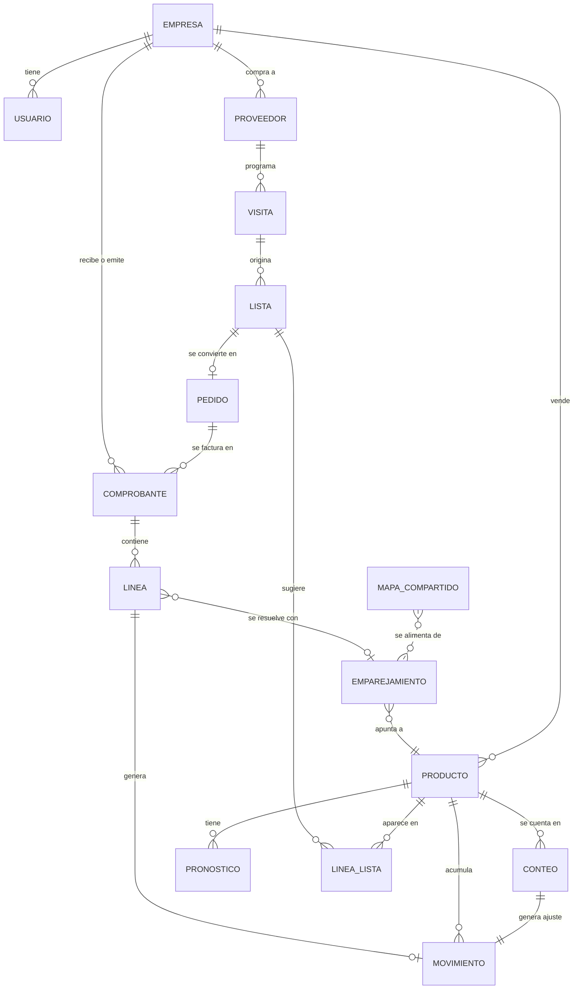

# 14 — Análisis funcional y requerimientos (P1-V7)

**Fecha:** 06/11/2026. Analiza la última versión: **V7 — Reposición para ferreterías a partir de comprobantes electrónicos, con catálogo compartido** (`12` §7 y `13`). Los archivos 00–13 no se modificaron.
**Diagrama de arquitectura:** `15_diagrama_de_arquitectura.md`.
**Prototipo navegable:** `prototipo/index.html` (HTML, CSS y JavaScript; datos simulados). Guía en `prototipo/README.md`.
**Etiquetas:** como en `10_fuentes_y_evidencias.md`. Fuentes nuevas F1–F6 en §14.
**Prioridad:** **Debe** = MVP y TSP · **Debería** = piloto pagado · **Podría** = después.

## 1. La última versión

| Aspecto | V7 |
|---|---|
| Cliente que paga | Ferretería formal de Lima, emisora electrónica (no Nuevo RUS [N8]), con 500–5 000 productos, **con o sin POS** |
| Usuarios del sistema | Dueño, encargado de compras, ayudante de tienda (conteo) |
| Quién **no** usa el sistema en el MVP | El vendedor del proveedor: recibe la lista por WhatsApp o impresa. En la fase 3 podría ver la sugerencia de sus productos (alternativa C, `12` §6) |
| Trabajo del cliente | Saber, cuando pasa el vendedor, qué se va a acabar antes de su próxima visita y qué tiene parado, para pedir lo justo sin gastar la caja de la semana (`12` §3) |
| Núcleo | (1) Inventario reconstruido desde los XML de compras y ventas · (2) Emparejamiento "confirma una vez" con catálogo compartido · (3) Lista de reposición para la visita de cada vendedor |
| Estado | 69 puntos, **demanda sin validar** (D 3?). V7 se descarta si menos del 60% de las líneas de boleta son identificables, y se vuelve a V2 con datos del POS (`13` §7) |

### 1.1 Hallazgos de este análisis que cambian el diseño

| # | Hallazgo | Consecuencia en los requerimientos |
|---|---|---|
| H1 | El **medio de entrega de la factura lo define el emisor**: página web, correo, servicio web u otros. El adquirente puede registrar un correo en el SEE para recibir lo que se le otorgue por ese medio [F1] | El reenvío de correo no captura todas las compras. Se agrega la carga manual de XML o ZIP (RF-ING-03) y el registro de "compra sin XML" (RF-ING-02, RF-ING-08). En la validación se mide el % de compras que llegan con XML (§13) |
| H2 | Si la boleta supera **S/ 700**, debe consignar el **nombre y el documento de identidad** del cliente [F2]. La factura siempre lleva el RUC del cliente | El XML de ventas **sí contiene datos personales**, al contrario de lo que suponía `06` §6. Los datos del adquirente se suprimen al ingerir (RF-ING-09, RN-06). La Ley 29733 aplica al tránsito del archivo (RNF-06) |
| H3 | UBL 2.1 tiene campos para el **código del vendedor** (`SellersItemIdentification`) y para el **código de producto SUNAT** (UNSPSC, catálogo 25) o GS1 (`CommodityClassification`). La obligatoriedad del código SUNAT es ambigua entre normas [F3] | La cascada usa el código del vendedor como llave de las compras y el código SUNAT o el GTIN como señal fuerte cuando existe (RF-EMP-02). En la validación se mide el % de líneas con código |
| H4 | La unidad de compra no es la de venta: el proveedor factura una caja de 12 o un rollo de 100 m, y la ferretería vende por unidad o por metro [I] | Factor de conversión obligatorio en cada emparejamiento de compra (RF-EMP-04, RN-11). Sin él, el stock se equivoca en múltiplos |
| H5 | **Bsale tiene una API REST** con documentos, detalles y stock [F4]. Para Nubefact no se encontró documentación oficial; una guía no oficial indica que la API devuelve XML, PDF y CDR [F5] | Resuelve en parte la búsqueda P2 de `10`. Conector de Bsale en el piloto (RF-ING-07). Un cliente de Bsale ya tiene stock, así que V7 le aporta solo la reposición (RF-STK-08). **El segmento natural de V7 es el comercio con facturador y sin inventario**. Bsale también podría copiar la función (`12` §8) |
| H6 | El conjunto **M5** figura con licencia CC BY 4.0 en un espejo de terceros. Para **Favorita** no se encontró la licencia [F6] | Usar M5 como base del generador de XML sintéticos (RF-MED-03) hasta confirmar en Kaggle. M5 son supermercados de EE. UU., no ferreterías: el TSP debe declararlo como limitación |
| H7 | Las ventas sin comprobante no aparecen en ningún XML [I] (`12` §8) | Conteo cíclico (CON) y merma estimada por categoría, mostrada aparte de los movimientos reales (RF-STK-06) |

## 2. Objetivo y alcance

**Objetivo:** que la ferretería (a) conozca su stock **sin digitarlo ni cambiar de POS**, (b) sepa con qué confianza lo conoce, y (c) llegue a la visita de cada vendedor con la lista de qué pedir y cuánto, y con sus productos parados valorizados en soles.

| Dentro del alcance | Fuera del alcance | Por qué queda fuera |
|---|---|---|
| Ingesta de XML de compras y ventas | Emisión de comprobantes (ser POS o facturador) | Bsale, Treinta y los PSE ya lo hacen (`00`, hallazgo 2) |
| Lectura UBL 2.1 y emparejamiento de productos | Uso de la Clave SOL o del SIRE | Lección de O4 (`12` §7) |
| Catálogo compartido entre comercios | Compartir cantidades, precios o proveedores de un comercio | Confidencialidad comercial (RN-08) |
| Stock teórico con confianza y conteo cíclico | Varios almacenes o sucursales | Fuera del MVP (`06` §3) |
| Pronóstico y reposición por proveedor | Envío automático de la orden al proveedor | El momento de decidir es la visita del vendedor (`12` §4) |
| Lista para la visita y productos parados | Marketplace de compras al estilo de TüL | Otra propuesta de valor (`12` §2) |
| Medición, backtesting y datos sintéticos | Contabilidad, cuentas por pagar y precios dinámicos | Fuera del problema |
| Vista de la marca (fase 3) | Crédito a la ferretería | Riesgo de terceros |

## 3. Sistemas

| ID | Sistema | Usuarios | Forma |
|---|---|---|---|
| S1 | Portal del comercio | Dueño, encargado de compras, ayudante | Web responsiva. La confirmación y el conteo se usan desde el celular |
| S2 | Plataforma central | La usan S1, S3 y S4 | API y servicios en la nube: correo entrante, ingesta, lector UBL, emparejamiento, libro de movimientos, pronóstico, reposición, medición y auditoría |
| S3 | Consola de la plataforma | Administrador del SaaS y curador del catálogo | Web interna: alta de empresas, soporte y conflictos del catálogo compartido |
| S4 | Vista de la marca | Vendedor de un proveedor que paga | Web; **fase 3**, solo con consentimiento del comercio |

| ID | Sistema externo | Uso |
|---|---|---|
| E1 | Correo del comercio, con regla de reenvío | Copia de las facturas XML de los proveedores hacia el buzón del sistema |
| E2 | Facturador, PSE o POS del comercio | XML o exportación de las ventas; API cuando exista (Bsale [F4]; otros [PI]) |
| E3 | WhatsApp del comercio | Enviar la lista al vendedor con un enlace `wa.me`, sin API |
| E4 | Consulta de validez de comprobantes de SUNAT (futuro) | Confirmar que un comprobante existe y no está anulado [N9] |
| E5 | Tipo de cambio | Valorizar las compras en dólares [PI: fuente oficial] |

## 4. Actores y permisos

| Acción | Dueño | Encargado de compras | Ayudante | Administrador SaaS | Vendedor de marca (fase 3) |
|---|:-:|:-:|:-:|:-:|:-:|
| Configurar empresa, proveedores, visitas y niveles de servicio | Sí | — | — | Solo el alta | — |
| Conectar el buzón y cargar archivos | Sí | Sí | — | Para soporte | — |
| Confirmar emparejamientos y factores | Sí | Sí | — | — | — |
| Registrar conteos | Sí | Sí | Sí | — | — |
| Ver stock, confianza y productos parados | Sí | Sí | Solo lo que cuenta | — | — |
| Ver y editar la lista para la visita | Sí | Sí | — | — | Solo la sugerencia de sus productos |
| Ver costos y capital parado en soles | Sí | Si el dueño lo habilita | — | — | — |
| Dar o revocar el consentimiento a una marca | Sí | — | — | — | — |
| Resolver conflictos del catálogo compartido | — | — | — | Sí | — |

El **vendedor del proveedor** no es usuario en el MVP. El **cliente final** de la ferretería tampoco: sus datos llegan en los XML de ventas y se suprimen al ingerir (H2). Dueño y encargado de compras pueden ser la misma persona.

## 5. Procesos

### 5.1 Hoy [H]

El vendedor de cada marca o distribuidora pasa en un día fijo. El dueño revisa los estantes y le pide de memoria "lo mismo que la vez pasada". Las facturas XML de los proveedores llegan al correo y se guardan para el contador. Las boletas salen del facturador. Nadie usa esos dos flujos juntos para saber el stock (`12` §3 y §4).

### 5.2 Con el sistema

| # | Proceso | Disparador | Pasos | Sistemas |
|---|---|---|---|---|
| PR1 | Alta y configuración | Contratación | Datos del comercio → proveedores (se crean solos con la primera factura) → días de visita, plazo y lote mínimo | S1 → S2 |
| PR2 | Conexión de fuentes | Alta | Regla de reenvío en el correo → primera carga de XML de ventas (exportación o API) → 1–3 meses de historial | E1, E2, S1 → S2 |
| PR3 | Ingesta | Llega un correo o un archivo | Extraer adjuntos → deduplicar → clasificar compra o venta → leer UBL → suprimir el adquirente | E1, S1 → S2 |
| PR4 | Emparejamiento | Líneas nuevas | Cascada automática → candidatos → "confirma una vez" con factor → mapa del comercio y catálogo compartido | S2 → S1 |
| PR5 | Arranque del inventario | Al tener el primer mes de ventas | Clase A preliminar → conteo inicial de esos productos → el resto queda "desconocido" | S2 → S1 |
| PR6 | Stock teórico | Cada movimiento nuevo | Último conteo + compras − ventas ± notas y ajustes → confianza por producto | S2 |
| PR7 | Conteo cíclico | Diario | Lista de 10 productos → conteo ciego en el celular → ajuste como movimiento nuevo | S2 → S1 → S2 |
| PR8 | Pronóstico y reposición | Tarea nocturna | Clasificación ABC y por patrón → pronóstico → política de revisión periódica por proveedor | S2 |
| PR9 | Lista para la visita | Tarde anterior a la visita | Lista sugerida → edición del dueño → impresa o por WhatsApp → registrar lo pedido | S2 → S1 → E3 |
| PR10 | Cierre del ciclo | Llega la factura del pedido | Comparar sugerido, pedido y facturado → plazo real → aceptación | E1 → S2 |
| PR11 | Medición | Continua | Calidad de datos, error del stock en conteos, backtesting, aceptación | S2 → S1 |

## 6. Requerimientos funcionales

### 6.1 Comercio, proveedores y visitas (COM)

| ID | Requerimiento | Sistema | Prioridad | Criterio de aceptación |
|---|---|---|---|---|
| RF-COM-01 | Registrar el comercio: RUC, razón social, facturador o PSE usado y régimen tributario | S1 | Debe | Si el régimen es Nuevo RUS, el sistema advierte que no hay XML de ventas y ofrece el modo POS o planilla (RF-ING-05) |
| RF-COM-02 | Proveedores: RUC, nombre comercial, vendedor y su celular, días de visita, plazo de entrega y lote o monto mínimo | S1 | Debe | El proveedor se crea solo con su primera factura; el dueño completa visita y plazo |
| RF-COM-03 | Calendario de visitas: semanal o cada N semanas, con excepciones por feriado | S1, S2 | Debe | La lista se genera la tarde anterior a cada visita (RF-REP-04) |
| RF-COM-04 | Estimar el plazo real del proveedor como mediana de (fecha de factura − fecha del pedido registrado) con 3 pedidos o más | S2 | Debería | Reemplaza al plazo declarado cuando difiere en más de 2 días [H] |
| RF-COM-05 | Nivel de servicio objetivo por clase ABC, configurable (por ejemplo, A 95%, B 90%, C 80% [H]) | S1 | Debe | — |

### 6.2 Ingesta de comprobantes (ING)

| ID | Requerimiento | Sistema | Prioridad | Criterio de aceptación |
|---|---|---|---|---|
| RF-ING-01 | Buzón por comercio con dirección única y no adivinable, para la regla de reenvío del correo donde llegan las facturas | S2 | Debe | Guía para Gmail y Outlook; primer XML recibido el mismo día de configurado |
| RF-ING-02 | Extraer de cada correo los adjuntos XML y ZIP (incluido el ZIP con XML, PDF y CDR). Un PDF sin XML se registra como "compra sin XML" | S2 | Debe | 100% de XML válidos procesados (`13` §6, objetivo 1) |
| RF-ING-03 | Carga manual de XML o ZIP desde el portal, para proveedores que publican en su web (H1) y para la exportación del facturador | S1 | Debe | Carga de un mes de comprobantes en una sola operación |
| RF-ING-04 | Idempotencia por clave del comprobante: RUC del emisor + tipo + serie + número | S2 | Debe | 0 duplicados al recibir el mismo comprobante 1 000 veces |
| RF-ING-05 | **Modo POS o planilla:** importar ventas desde la exportación Excel o CSV del POS, con la plantilla de `06` §3 | S1 | Debe | Es la ruta de los comercios sin XML de ventas y la vuelta a V2 si V7 falla el corte (§12) |
| RF-ING-06 | Clasificar cada comprobante como compra (el comercio es el adquirente) o venta (el comercio es el emisor). Rechazar los que no involucran su RUC | S2 | Debe | Rechazo con motivo, visible en RF-ING-08 |
| RF-ING-07 | Conector de API del facturador o POS (primero Bsale [F4]) para traer las ventas cada día sin exportación manual | S2 | Debería | Reintentos y registro de cada sincronización |
| RF-ING-08 | Reporte de ingesta: recibidos por día, rechazados con motivo, compras sin XML y proveedores sin facturas en X días | S1 | Debe | — |
| RF-ING-09 | Guardar el XML original de compras sin cambios y el de ventas **con los datos del adquirente suprimidos** (H2, RN-06) | S2 | Debe | Ningún nombre, DNI ni RUC de cliente final queda en la base ni en el almacén de archivos |

### 6.3 Lectura UBL 2.1 (UBL)

| ID | Requerimiento | Sistema | Prioridad | Criterio de aceptación |
|---|---|---|---|---|
| RF-UBL-01 | Leer factura (01), boleta (03), nota de crédito (07) y nota de débito (08) en UBL 2.1: emisor, adquirente, fecha y moneda; por línea, descripción, código del vendedor, código SUNAT o GTIN, unidad, cantidad y valor unitario (H3) | S2 | Debe | XML de prueba de 3 facturadores distintos o más; 100% de campos obligatorios leídos |
| RF-UBL-02 | Validar el esquema y la firma digital; marcar los inválidos sin descartarlos | S2 | Debería | — |
| RF-UBL-03 | Las notas de crédito revierten, total o parcialmente, las líneas del comprobante que referencian. Si el original no está, quedan pendientes | S2 | Debe | — |
| RF-UBL-04 | Marcar un comprobante como anulado y revertir su efecto con movimientos inversos | S1, S2 | Debería | — |
| RF-UBL-05 | Convertir a soles las compras en dólares con el tipo de cambio de su fecha | S2 | Debería | Fuente del tipo de cambio [PI] |
| RF-UBL-06 | Marcar líneas genéricas con una lista configurable: "VARIOS", "PRODUCTO", "MERCADERIA", "VENTA" y descripciones de menos de 4 caracteres | S2 | Debe | Es la métrica de corte de los días 3–5 de `13` §7 |

### 6.4 Emparejamiento de productos (EMP): núcleo de la V7

| ID | Requerimiento | Sistema | Prioridad | Criterio de aceptación |
|---|---|---|---|---|
| RF-EMP-01 | Catálogo del comercio: nombre normalizado, categoría, unidad base (la de venta) y clase ABC. **Se arma a partir de las líneas, no se digita** | S1, S2 | Debe | — |
| RF-EMP-02 | Cascada por línea: (1) mapa confirmado del comercio, por RUC del proveedor + código del vendedor en compras o por descripción normalizada en ventas; (2) GTIN o código SUNAT (H3); (3) catálogo compartido (RF-CAT-02); (4) reglas de normalización de abreviaturas, medidas ("1/2", "3/4") y materiales; (5) similitud semántica. Devuelve hasta 3 candidatos con puntaje | S2 | Debe | ≥ 90% de exactitud del primer candidato en un conjunto etiquetado (`13` §6, objetivo 2) |
| RF-EMP-03 | Pantalla **"confirma una vez"**: líneas sin mapa ordenadas por valor vendido. El usuario elige un candidato, crea un producto o marca "no es inventario" (flete, servicio) | S1 | Debe | ≤ 1 confirmación humana por producto (`13` §6, objetivo 2); usable en celular |
| RF-EMP-04 | **Factor de conversión** en cada emparejamiento de compra (H4, RN-11). Se sugiere desde la descripción ("X 12", "100M") y se confirma | S1, S2 | Debe | Ninguna compra afecta el stock sin factor confirmado |
| RF-EMP-05 | Aplicar automáticamente los mapas confirmados. Pedir nueva confirmación si cambia el código del proveedor o si la descripción difiere por encima de un umbral | S2 | Debe | — |
| RF-EMP-06 | Fusionar o separar productos del catálogo del comercio. El stock se recalcula desde los movimientos | S1 | Debería | — |
| RF-EMP-07 | Métricas: % de líneas emparejadas, por confirmar y genéricas, en valor y en cantidad | S1, S2 | Debe | — |

### 6.5 Catálogo compartido (CAT): alternativa B

| ID | Requerimiento | Sistema | Prioridad | Criterio de aceptación |
|---|---|---|---|---|
| RF-CAT-01 | Publicar en el catálogo compartido cada emparejamiento de compra confirmado: RUC del proveedor + código del vendedor ↔ descripción normalizada ↔ categoría ↔ unidad y factor. **Sin cantidades, precios ni identidad del comercio** (RN-08) | S2 | Debería | Prueba automatizada: ninguna tabla del catálogo compartido tiene `empresa_id`, cantidades ni precios |
| RF-CAT-02 | Aplicar un mapa compartido como paso 3 de la cascada solo si lo confirmaron 2 comercios distintos o más [H], o el curador | S2 | Debería | El emparejamiento queda marcado "por catálogo compartido" y el comercio puede corregirlo |
| RF-CAT-03 | Curaduría de conflictos: dos comercios confirmaron productos distintos para el mismo código | S3 | Debería | — |
| RF-CAT-04 | Medir el efecto de red: % de líneas de un comercio nuevo emparejadas por el catálogo compartido en su primera semana | S2 | Debería | Reporte por cohorte de alta |

### 6.6 Stock teórico y confianza (STK)

| ID | Requerimiento | Sistema | Prioridad | Criterio de aceptación |
|---|---|---|---|---|
| RF-STK-01 | Libro de movimientos de solo inserción por producto: compra, venta, nota de crédito, inventario inicial, ajuste por conteo y merma | S2 | Debe | El stock es una suma de movimientos; no hay campo editable |
| RF-STK-02 | Arranque: inventario inicial por conteo de los productos clase A (calculada con 1–3 meses de ventas) o stock declarado. El resto empieza como "desconocido" | S1, S2 | Debe | Arranque en ≤ 2 horas de trabajo del comercio [H] |
| RF-STK-03 | Stock teórico diario = último conteo + compras − ventas ± notas y ajustes posteriores | S2 | Debe | — |
| RF-STK-04 | Confianza por producto (alta, media o baja) según los días desde el último conteo, la diferencia de ese conteo, el % de líneas genéricas de su categoría y los movimientos desde el conteo | S2 | Debe | Visible junto al stock y en la lista para la visita |
| RF-STK-05 | Un stock negativo o imposible se muestra como "requiere conteo" y entra con prioridad al conteo cíclico (RN-13) | S2 | Debe | — |
| RF-STK-06 | Merma no explicada por categoría, estimada con las diferencias de conteo y aplicada como ajuste esperado a los productos sin conteo reciente (H7) | S2 | Debería | Se muestra como "estimado", separado de los movimientos reales |
| RF-STK-07 | Compras en tránsito: pedidos registrados (RF-REP-07) cuya factura no llegó | S2 | Debería | — |
| RF-STK-08 | **Modo stock del POS:** si el comercio tiene POS con inventario (Bsale por API), usar ese stock en lugar de reconstruirlo (H5) | S2 | Podría | — |

### 6.7 Conteo cíclico (CON)

| ID | Requerimiento | Sistema | Prioridad | Criterio de aceptación |
|---|---|---|---|---|
| RF-CON-01 | Lista diaria de N productos a contar (10 por defecto [H]), priorizada por valor (clase A), por incertidumbre (confianza baja) y por cercanía de la visita del proveedor | S1, S2 | Debe | — |
| RF-CON-02 | Registrar el conteo desde el celular, por búsqueda o código de barras, **sin mostrar el stock teórico antes de contar** (conteo ciego) | S1 | Debe | ≤ 20 s por producto [H] |
| RF-CON-03 | Cada conteo genera un ajuste = contado − teórico, como movimiento nuevo con motivo | S2 | Debe | — |
| RF-CON-04 | Registrar el error del stock teórico en cada conteo (\|teórico − contado\| ÷ contado), por clase | S2 | Debe | Error absoluto mediano ≤ 10% en clase A (`13` §6, objetivo 3) |
| RF-CON-05 | Conteo de verificación de 30 productos elegidos al azar por clase, para la validación y el TSP | S1, S2 | Debe | Días 5–8 de `13` §7 |

### 6.8 Pronóstico (PRO)

| ID | Requerimiento | Sistema | Prioridad | Criterio de aceptación |
|---|---|---|---|---|
| RF-PRO-01 | Clasificar cada mes los productos por ABC (valor vendido) y por patrón de demanda: suave, errática, intermitente o irregular (ADI y CV², Syntetos-Boylan) | S2 | Debe | — |
| RF-PRO-02 | Pronóstico semanal por producto con 4 métodos o más: ingenuo, ETS, Croston o SBA, TSB y un modelo global LightGBM | S2 | Debe | `11` §7, objetivo 3, y `13` §6, objetivo 4 |
| RF-PRO-03 | Elegir el método por segmento ABC × patrón con *backtesting* de origen móvil. Métrica principal MASE; también WAPE y sesgo | S2 | Debe | MASE < 1 en clase A |
| RF-PRO-04 | Excluir o corregir las semanas censuradas, con stock teórico ≤ 0, al ajustar los modelos (RN-10) | S2 | Debe | — |
| RF-PRO-05 | Calendario peruano: feriados, quincenas y campañas (Fiestas Patrias, diciembre) como variables del modelo global | S2 | Debería | — |
| RF-PRO-06 | Pronóstico por categoría, repartido por participación, para productos con menos de 8 semanas de historial [H] | S2 | Debe | Riesgo de historial corto de `06` §7 |

### 6.9 Reposición y lista para la visita (REP)

| ID | Requerimiento | Sistema | Prioridad | Criterio de aceptación |
|---|---|---|---|---|
| RF-REP-01 | **Revisión periódica por proveedor:** nivel objetivo = demanda pronosticada en (plazo + días hasta la siguiente visita) + stock de seguridad según el nivel de servicio de la clase. Cantidad = nivel objetivo − stock teórico − en tránsito, redondeada al lote o empaque del proveedor | S2 | Debe | Simulación: ≥ 30% menos semanas con quiebre que el método ingenuo (`11` §7, objetivo 4) |
| RF-REP-02 | Si la confianza del stock es baja, no sugerir cantidad: mostrar "cuenta antes de pedir" y agregarlo al conteo del día | S2 | Debe | — |
| RF-REP-03 | Explicación simple por línea, por ejemplo: "Pide 12: vendes 3 por semana, el proveedor tarda 5 días y vuelve en 7; te quedan 4" | S1, S2 | Debe | Se genera con una plantilla a partir de los números, sin LLM (`06` §1) |
| RF-REP-04 | **Lista para la visita** de cada proveedor, generada la tarde anterior: productos a pedir con cantidad, stock y confianza; productos del proveedor que no hace falta pedir; total en soles | S1 | Debe | — |
| RF-REP-05 | Tope de caja semanal: si la lista lo supera, se recorta priorizando la clase A y el riesgo de quiebre | S1, S2 | Debería | — |
| RF-REP-06 | Editar la lista y compartirla impresa, en PDF o por WhatsApp con el texto ya escrito (enlace `wa.me`) | S1 | Debe | Sin API ni costo por mensaje |
| RF-REP-07 | Registrar lo pedido realmente (por defecto, la lista editada) como pedido en tránsito | S1 | Debe | — |
| RF-REP-08 | Cerrar el ciclo cuando llega la factura del proveedor: comparar sugerido, pedido y facturado, y calcular el plazo real | S2 | Debe | Aceptación de la sugerencia ≥ 60% [H] (`07` §5) |
| RF-REP-09 | Alertar en el portal y por correo un quiebre probable de clase A antes de la próxima visita | S2 | Debería | — |

### 6.10 Productos parados (PAR)

| ID | Requerimiento | Sistema | Prioridad | Criterio de aceptación |
|---|---|---|---|---|
| RF-PAR-01 | Productos sin venta en X días (60 por defecto [H]) con stock teórico > 0, valorizados al último costo de compra en soles | S1, S2 | Debe | El total de "capital parado" aparece en el inicio |
| RF-PAR-02 | Sugerir una acción informativa: no volver a pedir, devolver al proveedor si lo acepta o liquidar | S1 | Podría | — |

### 6.11 Medición y evaluación (MED)

| ID | Requerimiento | Sistema | Prioridad | Criterio de aceptación |
|---|---|---|---|---|
| RF-MED-01 | Reporte semanal de calidad de datos: % de líneas identificables, emparejadas y con código | S1, S2 | Debe | Es la métrica de corte (< 60%) de `13` §7 |
| RF-MED-02 | *Backtesting* del pronóstico y simulación de la política con el historial del comercio, reproducibles | S2 | Debe | — |
| RF-MED-03 | **Generador de datos sintéticos:** convierte un conjunto público de ventas (M5, H6) en XML UBL 2.1 de compras y ventas, con ruido controlado: % de líneas genéricas, % de ventas sin comprobante y variantes de descripción por proveedor | S2 | Debe | `13` §6, objetivo 5; semilla registrada |
| RF-MED-04 | Sensibilidad: error del stock y del pronóstico en función del % de líneas genéricas y de ventas sin comprobante | S2 | Debe | Curva de error por nivel de ruido |
| RF-MED-05 | Reporte mensual al dueño: quiebres de clase A, capital parado, aceptación de la sugerencia y error del stock en los conteos | S1 | Debería | — |

### 6.12 Usuarios, empresas y auditoría (SEG)

| ID | Requerimiento | Sistema | Prioridad | Criterio de aceptación |
|---|---|---|---|---|
| RF-SEG-01 | Multiempresa: `empresa_id` en cada tabla del comercio; ninguna consulta cruza empresas; el catálogo compartido vive en un esquema aparte | S2 | Debe | Pruebas de aislamiento |
| RF-SEG-02 | Roles y permisos de §4 | S1, S2 | Debe | — |
| RF-SEG-03 | Auditoría de solo inserción: confirmaciones, ajustes, cambios de parámetros y sugerido frente a pedido | S2 | Debe | Requisito 7 del MVP de `06` §3 |
| RF-SEG-04 | Rotar o revocar la dirección del buzón | S1 | Debe | Los correos a la dirección revocada se rechazan |
| RF-SEG-05 | Alta de empresas, planes y soporte | S3 | Debería | En el MVP, el alta puede hacerse por script |

### 6.13 Vista de la marca (MAR): alternativa C

| ID | Requerimiento | Sistema | Prioridad | Criterio de aceptación |
|---|---|---|---|---|
| RF-MAR-01 | Consentimiento del comercio por marca o proveedor, revocable en cualquier momento | S1 | Podría | — |
| RF-MAR-02 | El vendedor de la marca ve, antes de la visita, solo la sugerencia de sus productos, sin stock de otras marcas ni ventas totales | S4 | Podría | — |
| RF-MAR-03 | La sugerencia es idéntica con o sin marca pagadora (RN-07) | S2 | Podría | Prueba automatizada de neutralidad |

**Total:** 74 requerimientos funcionales. 52 Debe · 17 Debería · 5 Podría.

## 7. Reglas de negocio

| ID | Regla |
|---|---|
| RN-01 | Un comprobante se identifica por RUC del emisor + tipo + serie + número y se procesa una sola vez |
| RN-02 | Una nota de crédito revierte solo las líneas y cantidades que referencia; nunca más de lo facturado |
| RN-03 | Un movimiento registrado no se edita: las correcciones son movimientos nuevos que referencian al original |
| RN-04 | Una línea no afecta el stock hasta estar emparejada; mientras tanto suma en el % "por confirmar" |
| RN-05 | Las líneas genéricas no se asignan a ningún producto; suman en el % "no identificable" y bajan la confianza de la categoría si se puede inferir |
| RN-06 | Los datos del adquirente de las ventas (nombre, DNI, RUC) se suprimen al ingerir; solo se guarda si fue boleta o factura |
| RN-07 | La sugerencia es la misma con o sin marca pagadora |
| RN-08 | El catálogo compartido guarda solo el mapa de productos; nunca cantidades, precios ni la identidad del comercio |
| RN-09 | Cada mapa nuevo requiere una confirmación humana; después se aplica solo, salvo los cambios de RF-EMP-05 |
| RN-10 | Las semanas con stock teórico ≤ 0 se marcan como censuradas para el pronóstico |
| RN-11 | La unidad base del producto es la de venta; las compras se convierten con el factor confirmado |
| RN-12 | No se pide ni se usa la Clave SOL del comercio |
| RN-13 | Un stock negativo no se muestra como número: se muestra "requiere conteo" |

## 8. Datos principales

| Entidad | Campos clave | Nota |
|---|---|---|
| COMPROBANTE | RUC del emisor, tipo, serie, número, dirección (compra o venta), fecha, moneda, ubicación del XML original | Su clave es la llave de idempotencia (RN-01) |
| LINEA | descripción original y normalizada, código del vendedor, código SUNAT o GTIN, unidad, cantidad, valor unitario, genérica sí o no | Sin datos del adquirente (RN-06) |
| EMPAREJAMIENTO | clave (RUC del proveedor + código del vendedor, o descripción normalizada), producto, factor, origen (confirmado, compartido o regla), confirmado por | Une el XML con el catálogo del comercio |
| MOVIMIENTO | producto, tipo, cantidad en unidad base, costo, fecha, origen (línea, conteo o ajuste) | **Fuente de verdad del stock**: el saldo es una suma |
| CONTEO | producto, contado, teórico al momento, error, usuario | Alimenta la confianza y el objetivo 3 del TSP |
| MAPA_COMPARTIDO | RUC del proveedor + código del vendedor, descripción normalizada, categoría, unidad, factor, n.º de confirmaciones | Esquema aparte, **sin `empresa_id`** (RN-08) |
| LISTA | proveedor, fecha de visita, total en soles, estado (sugerida, editada o enviada) | Se compara con el pedido y la factura (RF-REP-08) |

## 9. Requerimientos no funcionales

| ID | Categoría | Requerimiento y meta |
|---|---|---|
| RNF-01 | Ingesta | Un correo se procesa en < 15 min desde su llegada; un lote de 1 000 XML en < 5 min [H] |
| RNF-02 | Cálculo nocturno | Pronóstico y reposición de un comercio con 5 000 productos en < 10 min de CPU [H] (`06` §5) |
| RNF-03 | Usabilidad | SUS ≥ 70 (`11` §7); confirmación y conteo usables en celular; un producto confirmado en ≤ 10 s [H] |
| RNF-04 | Seguridad de archivos | Lector XML sin entidades externas (XXE); límites de tamaño y de descompresión de ZIP; los adjuntos nunca se ejecutan; OWASP ASVS como referencia [I] |
| RNF-05 | Seguridad del buzón y del acceso | Dirección con token aleatorio de 128 bits o más; solo se aceptan comprobantes donde el RUC del comercio es emisor o adquirente; TLS; segundo factor opcional para el dueño |
| RNF-06 | Datos personales | Ley 29733 y DS 016-2024-JUS (`../p5-pedidos-y-entregas-offline/14` F4). Supresión del adquirente al ingerir (H2); contrato de encargo de tratamiento con cada comercio; sin Clave SOL (RN-12) |
| RNF-07 | Confidencialidad comercial | Costos, ventas y proveedores de un comercio nunca salen de su empresa; el catálogo compartido solo guarda el mapa (RN-08) |
| RNF-08 | Integridad y respaldo | XML originales inmutables; libro de movimientos de solo inserción; respaldo diario; **reprocesar todo desde los XML da el mismo stock** |
| RNF-09 | Reproducibilidad | *Backtesting*, generador sintético y emparejamiento con semilla y versión del modelo registradas |
| RNF-10 | Disponibilidad | 99% mensual [H]. Si la plataforma cae, los correos esperan en el servicio de entrada y se procesan después |
| RNF-11 | Escala | 300 comercios × 300 comprobantes al día × 3 líneas ≈ 270 000 líneas diarias, unos 100 millones al año [H]. PostgreSQL con partición mensual de líneas y movimientos [I] |
| RNF-12 | Costo | Infraestructura del MVP de USD 30–80 al mes (`06` §5), más el correo entrante [PI]; similitud con un modelo pequeño en CPU |
| RNF-13 | Pruebas | Conjunto de XML de prueba por facturador; pruebas automatizadas de idempotencia, notas de crédito y aislamiento en cada cambio |
| RNF-14 | Localización | Español; soles; fecha dd/mm/aaaa; zona horaria America/Lima; unidades del catálogo de SUNAT [I] |

## 10. Integraciones

| Externo | Para qué | Mecanismo | Fase | Datos verificados o pendientes |
|---|---|---|---|---|
| Correo del comercio | Compras de los proveedores | Regla de reenvío hacia el buzón del sistema; servicio de correo entrante con webhook | MVP | El emisor elige el medio de entrega [F1]: parte de las compras llegará por web y se cargará a mano |
| Exportación del facturador | Ventas | Carga de XML o ZIP desde el portal | MVP | Qué facturadores exportan el XML en lote [PI] |
| Exportación del POS | Ventas en modo V2 | Excel o CSV con plantilla | MVP | — |
| API de Bsale | Ventas y, opcionalmente, stock | REST con token | Piloto | Documentos, detalles y stock en la API [F4]; autenticación y límites [PI] |
| API de Nubefact u otros PSE | Ventas | API del proveedor | Piloto | Sin documentación oficial revisada [F5] [PI] |
| WhatsApp del comercio | Lista para el vendedor | Enlace `wa.me` con el texto | MVP | Sin costo por mensaje |
| Consulta de validez de SUNAT | Detectar anulados | Servicio web de consulta | Después | [N9]; credenciales y límites [PI] |
| Tipo de cambio | Compras en dólares | Tabla diaria | Piloto | Fuente oficial [PI] |

## 11. Trazabilidad

### 11.1 De las necesidades a los requerimientos

| Necesidad (`12` §3 y §4) | Requerimientos | Cómo se mide |
|---|---|---|
| Empuje: quiebre de los productos que más salen | PRO, RF-REP-01, RF-REP-09 | Semanas con quiebre de clase A, −30% en simulación |
| Empuje: capital parado en lo que no rota | PAR | Capital parado en soles |
| Atracción: llegar a la visita con el pedido armado | RF-COM-03, RF-REP-04, RF-REP-06 | % de visitas con lista; aceptación ≥ 60% |
| Ansiedad: "no sé mi stock real" | STK, CON | Error mediano ≤ 10% en clase A |
| Ansiedad: "tendría que cargar todo" | ING, EMP, CAT | ≤ 1 confirmación por producto; arranque ≤ 2 h |
| Ansiedad: "la máquina no conoce mi negocio" | RF-REP-02, RF-REP-03, RF-REP-06 | Aceptación de la sugerencia; ediciones por lista |
| Hábito: pedir de memoria al vendedor | RF-REP-06, RF-REP-07 | Listas usadas en visitas reales |
| Necesidad 1: stock sin POS ni conteo completo | ING, UBL, STK | % de productos con confianza alta |
| Necesidad 2: emparejar nombres | EMP, CAT | Exactitud ≥ 90%; efecto de red (RF-CAT-04) |

### 11.2 De los objetivos del TSP (`13` §6) a los requerimientos

| Objetivo | Requerimientos |
|---|---|
| 1. Ingesta y lector UBL 2.1 | RF-ING-01 a RF-ING-04, RF-ING-06, RF-UBL-01, RF-UBL-03 |
| 2. Emparejamiento de descripciones | RF-EMP-02 a RF-EMP-05, RF-EMP-07 |
| 3. Reconstrucción del stock | RF-STK-01 a RF-STK-05, RF-CON-01 a RF-CON-05 |
| 4. Comparación de métodos de pronóstico | RF-PRO-01 a RF-PRO-04, RF-MED-02 |
| 5. Efecto del ruido con datos sintéticos | RF-MED-03, RF-MED-04 |

## 12. Fases

| Fase | Qué incluye | Condición para pasar |
|---|---|---|
| 0. Validación (2 semanas, `13` §7) | XML reales de 3–5 ferreterías, procesados con un cuaderno de Python; sin desarrollo | Si menos de 2 entregan XML, el acceso es el problema: volver a V2. **Menos de 60% de líneas identificables: descartar V7** y volver a V2. Error mediano del stock > 25%: replantear. Si 4 o más aceptan que la marca vea su sugerencia: probar la alternativa C |
| 1. MVP y TSP | Los 52 "Debe". Estimación: 14–16 semanas para dos personas [H], más que las 8–10 de `06` §3 por la ingesta, el lector UBL, el emparejamiento y el stock teórico | Objetivos de `13` §6 cumplidos |
| 2. Piloto pagado | Los 17 "Debería": catálogo compartido, conector de Bsale, merma estimada, tope de caja, alertas | Una ferretería paga |
| 3. Después | Los 5 "Podría": vista de la marca, modo stock del POS y acciones sobre productos parados | Marca dispuesta a pagar o pedido de clientes |

**Si la validación falla (< 60%):** las ventas entran por el modo POS (RF-ING-05), el stock lo da el POS (RF-STK-08 pasa a Debe) y se quitan el lector UBL de ventas y la reconstrucción del stock. Se conservan el XML de compras (costos y plazos reales), el emparejamiento de compras, el pronóstico, la reposición y la lista para la visita, así que el núcleo técnico del TSP se mantiene.

## 13. Supuestos y pendientes

| # | Supuesto o pendiente | Afecta a | Cómo se resuelve |
|---|---|---|---|
| 1 | Demanda sin validar (D 3?) | Todo | Fase 0 |
| 2 | % de líneas de boleta identificables y % de compras que llegan con XML (H1) | ING, EMP, STK | Días 1–5 de la validación |
| 3 | Qué facturadores exportan el XML en lote o tienen API | RF-ING-03, RF-ING-07 | Documentación y cuentas de prueba de Nubefact y otros PSE |
| 4 | Obligatoriedad vigente del código SUNAT por línea (H3) | RF-EMP-02 | Revisar la resolución vigente |
| 5 | Licencia de M5 y de Favorita (H6) | RF-MED-03 | Página original en Kaggle |
| 6 | Fuente oficial del tipo de cambio | RF-UBL-05 | SBS o SUNAT |
| 7 | Valores por defecto [H]: niveles de servicio, N de conteo, días de "parado" y metas de rendimiento | REP, CON, RNF | Ajustarlos con los datos del piloto |
| 8 | El sistema guarda copias del XML, pero no reemplaza la obligación de conservación tributaria del comercio | RNF-08 | Aclararlo en el contrato |

## 14. Fuentes nuevas

Todas se leyeron solo como fragmento del buscador: confirmarlas en la página antes de citarlas en el TSP.

| ID | Fuente | Qué respalda | Tipo | Lect. |
|---|---|---|---|---|
| F1 | SUNAT, orientación: constancia de recepción, conservación y otorgamiento — https://orientacion.sunat.gob.pe/node/751 ; SEE del contribuyente — https://cpe.sunat.gob.pe/sistema_emision/see_contribuyente | El emisor define el medio de entrega (web, correo, servicio web); el adquirente puede registrar un correo para recibir comprobantes | [V] | B |
| F2 | SUNAT, orientación: boleta de venta — https://orientacion.sunat.gob.pe/03-boleta-de-venta | Por encima de S/ 700 se consignan el nombre y el documento del cliente | [V] | B |
| F3 | SUNAT, código de producto — https://cpe.sunat.gob.pe/informacion_general/codigoproducto ; anexos de la RS 245-2017 — https://www.sunat.gob.pe/legislacion/superin/2017/anexoF,G,H-245-2017.pdf ; conceptos generales (RS 133-2019) — https://cpe.sunat.gob.pe/informacion_general/conceptos_generales | Código SUNAT basado en UNSPSC, o GS1; campos `SellersItemIdentification` y `CommodityClassification`; obligatoriedad ambigua; UBL 2.1 exigido | [V] | B |
| F4 | Bsale, documentación de la API — https://docs.bsale.dev/stocks ; wiki de la comunidad — https://github.com/gmontero/API-Bsale-PE/wiki/ | API REST con stock, recepciones, documentos y detalles | [C]/[S] | B |
| F5 | `nubefact-python` en PyPI — https://pypi.org/project/nubefact-python/ | Consulta de comprobantes por tipo, serie y número; documentación oficial no revisada | [S] | B |
| F6 | Zenodo, espejo de M5 — https://zenodo.org/records/12636070 | M5 figura con CC BY 4.0 (copia de terceros); licencia de Favorita no encontrada | [S] | B |
