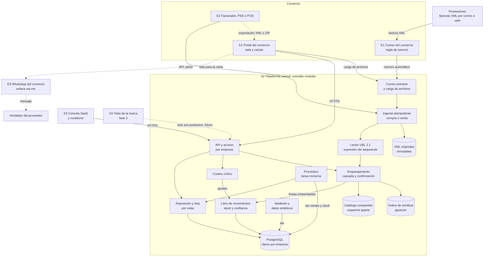
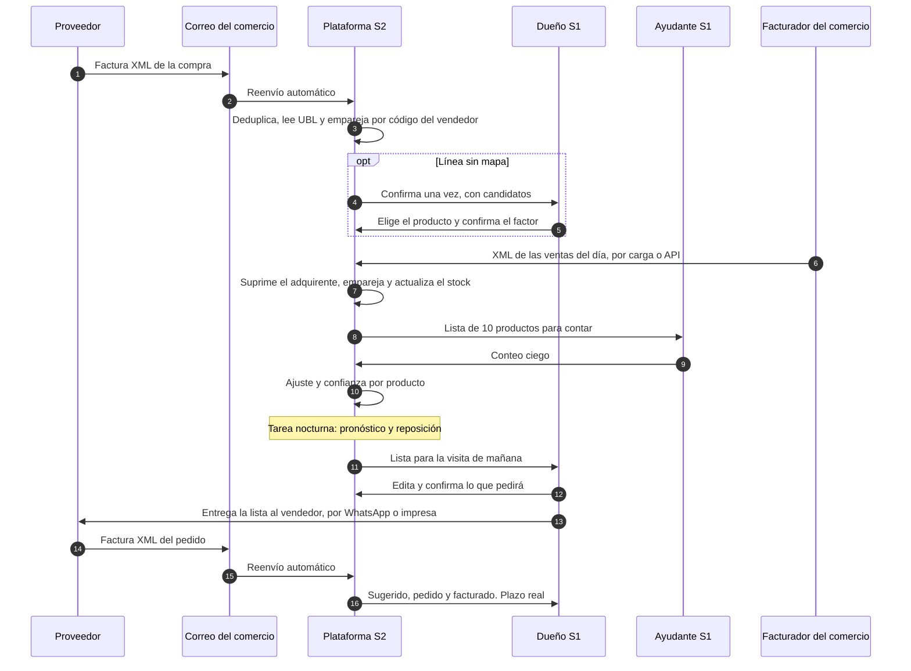
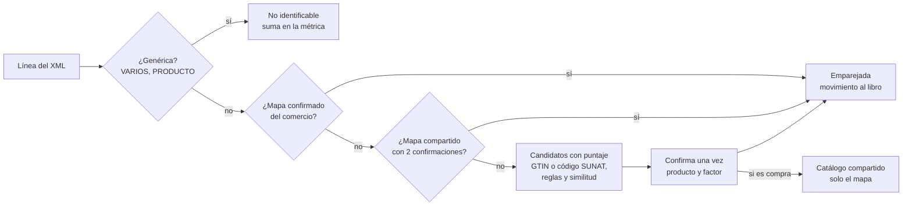

# 15 — Diagrama de arquitectura (P1-V7)

**Fecha:** 06/11/2026. Complementa `14_analisis_funcional_y_requerimientos.md` y actualiza para la V7 el esquema de `06` §2. Los sistemas S1–S4 y E1–E5 son los de `14` §3.

## 1. Cómo se conectan los sistemas

Líneas continuas: conexiones del sistema. Líneas punteadas: acciones de una persona (exportar del facturador, enviar por WhatsApp) o integraciones futuras.

**Lectura:**

- **El comercio no digita su inventario.** Las compras llegan solas por la regla de reenvío del correo. Las ventas llegan por carga de archivos y, en el piloto, por la API del facturador o del POS (`14` RF-ING).
- **Todo comprobante entra una sola vez.** La clave RUC + tipo + serie + número hace que reenvíos y cargas repetidas no dupliquen el stock (`14` RN-01).
- **El XML original se guarda sin cambios**, con el adquirente de las ventas suprimido. Si mejora el lector o el emparejamiento, se reprocesa todo y el stock se recalcula desde cero (`14` RNF-08).
- **El libro de movimientos es la fuente de verdad.** El stock y su confianza son sumas de compras, ventas, notas y ajustes por conteo.
- **El catálogo compartido está en un esquema aparte, sin `empresa_id`.** Guarda solo el mapa de productos, así que no puede mezclar datos de dos comercios (`14` RN-08).
- **El pronóstico y la reposición son una tarea nocturna.** Dejan lista, la tarde anterior, la lista para la visita de cada vendedor.

## 2. Flujo principal: de la factura del proveedor a la lista para la visita

**En la validación (fase 0), la plataforma es un cuaderno de Python.** El equipo carga los XML a mano, calcula el stock y entrega la lista en una hoja de cálculo (`08` §2.5 y `13` §7). El flujo es el mismo.

## 3. Cascada de emparejamiento

El orden va de lo más seguro a lo más incierto. Los pasos automáticos solo aplican mapas ya confirmados por una persona, del propio comercio o de dos comercios distintos (`14` RF-EMP-05 y RF-CAT-02). Lo demás siempre pasa por "confirma una vez".

## 4. Conexiones

| Origen → destino | Qué viaja | Protocolo | Nota |
|---|---|---|---|
| Proveedor → E1 | Factura XML | Correo | El proveedor elige el medio; algunos solo publican en su web (`14` H1) |
| E1 → S2 | Copia del correo con adjuntos | Regla de reenvío → servicio de correo entrante → webhook | El sistema no entra al buzón del comercio ni pide su contraseña |
| S1 → S2 | XML o ZIP cargados, confirmaciones, conteos, listas | HTTPS, sesión de usuario | — |
| E2 → S2 | Ventas del día | API REST con token (Bsale [F4]); otros [PI] | Piloto |
| S2 → S1 | Stock, confianza, lista para la visita, alertas | HTTPS; correo para alertas | — |
| S1 → E3 → vendedor | Lista con el texto ya escrito | Enlace `wa.me` | Sin API ni costo por mensaje |
| S4 → S2 | Sugerencia de los productos de una marca | HTTPS, solo con consentimiento | Fase 3 |
| S2 → E4 | Validez de un comprobante | Servicio web de consulta de SUNAT | Después [PI] |

## 5. Decisiones de arquitectura

| Decisión | Por qué |
|---|---|
| Monolito modular en Python (FastAPI), no microservicios | Equipo de dos personas; mismo lenguaje que los modelos (`06` §2) y que el antecedente UPC [S11] |
| XML originales inmutables y reprocesamiento determinista | El lector y el emparejamiento van a mejorar; el stock debe poder recalcularse desde cero con el mismo resultado |
| Clave del comprobante como llave de idempotencia | Reenvíos, cargas repetidas y la API pueden traer el mismo comprobante varias veces |
| Libro de movimientos de solo inserción | El stock es una suma auditable, con el mismo principio que P5 (`../p5-pedidos-y-entregas-offline/15` §4) |
| Reenvío de correo en lugar de leer el buzón (IMAP u OAuth) | No pide credenciales del comercio, con la misma lógica que no usar la Clave SOL (`14` RN-12) |
| Similitud con *embeddings* de un modelo pequeño multilingüe en CPU y `pgvector` | Basta para proponer candidatos y es barato. **Sin LLM en el núcleo** (`06` §1): la decisión la confirma una persona |
| Catálogo compartido en un esquema aparte, sin `empresa_id` | El aislamiento queda en la estructura y no solo en las consultas (`14` RN-08) |
| Pronóstico con `statsforecast` y LightGBM; tareas con cron y un worker | Lo de `06` §2: libre y corre en CPU |
| Servicio de correo entrante gestionado (por ejemplo, Amazon SES, Mailgun o Postmark) | Recibir correo propio es caro de operar [PI: costo y región] |
| Lector XML sin entidades externas y con límites de ZIP | Los adjuntos vienen de terceros (`14` RNF-04) |

## 6. Reutilización

- **Suite para distribuidoras:** el pronóstico y la reposición son el mismo motor del módulo M3 (pedido sugerido, P1-V6) de `../iteracion-2_01_integraciones_y_suite_distribuidoras.md` §1. Para la suite cambian el cliente (la distribuidora sugiere a sus bodegas) y la fuente (su historial de pedidos en lugar de XML).
- **Motor compartido de series cortas:** el tratamiento de demanda intermitente y la evaluación con MASE son los que `../iteracion-2_01_integraciones_y_suite_distribuidoras.md` §4 comparte con el intervalo de reposición de P5-V6.
- **Patrón de ingesta idempotente:** es el mismo de la sincronización de P5 (`../p5-pedidos-y-entregas-offline/14` RF-SYN), aplicado a comprobantes en vez de eventos del celular.
