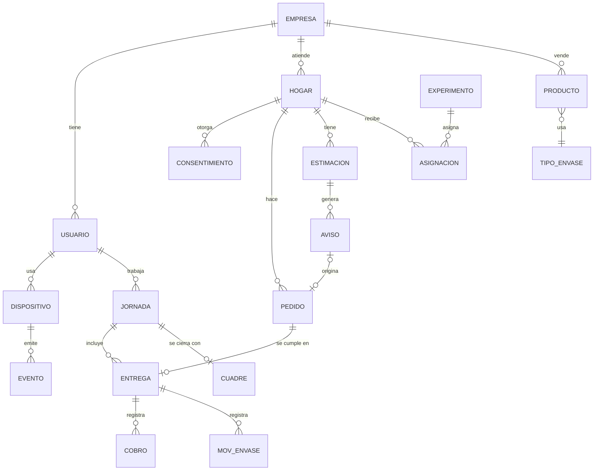

# 14 — Análisis funcional y requerimientos (P5-V6)

**Fecha:** 06/11/2026. Analiza la última versión: **V6 — Reparto de GLP y agua en envases retornables, con reposición anticipada** (`12` §7 y `13`). Los archivos 00–13 no se modificaron.
**Diagrama de arquitectura:** `15_diagrama_de_arquitectura.md`.
**Prototipo navegable:** `prototipo/index.html` (HTML, CSS y JavaScript; datos simulados). Guía en `prototipo/README.md`.
**Etiquetas:** como en `10_fuentes_y_evidencias.md`. Fuentes nuevas F1–F4 en §14.
**Prioridad:** **Debe** = MVP y TSP · **Debería** = piloto pagado · **Podría** = después.

## 1. La última versión

| Aspecto | V6 |
|---|---|
| Cliente que paga | Local o distribuidor de GLP autorizado, o distribuidora de agua en bidones, con 1–10 repartidores |
| Usuarios del sistema | Dueño, despachador, repartidor |
| Quién **no** usa el sistema | El hogar: solo recibe y responde mensajes de WhatsApp (`03` §3, patrón 3) |
| Trabajo del cliente | Que el hogar le compre a él y no al local más barato de Facilito, avisándole antes de que se le acabe el balón o el bidón (`12` §4) |
| Núcleo | (1) Reposición anticipada · (2) Libro de envases · (3) Reparto y cobro sin conexión, con cuadre |
| Estado | 71 puntos, **demanda sin validar** (D 3?). La reposición anticipada se descarta si el Mago de Oz da < 10% de respuesta (`13` §7) |

### 1.1 Hallazgos de este análisis que cambian el diseño

| # | Hallazgo | Consecuencia en los requerimientos |
|---|---|---|
| H1 | Meta cobra **por mensaje entregado** desde el 01/07/2025 y solo permite escribir a usuarios que **dieron su consentimiento** [F1]. Un aviso de recompra sin pedido abierto **probablemente es "marketing"**: las plantillas de "utilidad" deben ser no promocionales y responder a una solicitud o transacción del usuario, y las de renovación o recompra son marketing [F2] | Consentimiento registrado por hogar (RF-CLI-02); costo por mensaje visible (RF-MSG-05); **modo manual sin API** para validar sin pagar mensajes (RF-REP-06) |
| H2 | Desde el 01/10/2026 Meta también cobra los mensajes de utilidad dentro de la ventana de 24 h y los de servicio por encima de 1 000 al mes por número [F1] | El costo de mensajería entra en el retorno que se muestra al distribuidor (RF-EXP-04) |
| H3 | Yape con Culqi pide **celular y código de aprobación** generado en la app Yape, con vigencia de 2 minutos, tope de S/ 2 000 y solo soles. Integrar la API directa de tokens exige **PCI DSS (SAQ-D)** [F3] | La app del repartidor **no captura datos de Yape**. El hogar paga en el checkout de la pasarela desde su propio celular (RF-COB-03), o con el QR del negocio verificado en el cuadre (RF-COB-02) |
| H4 | El repartidor puede estar sin señal cuando el hogar paga desde su celular | El pago se confirma en el servidor y se concilia después con la entrega; el cuadre admite cobros "por verificar" (RF-COB-02, RF-CUA-04) |
| H5 | El consumo del hogar es irregular: varios balones, leña ocasional (`12` §6 A) | Duración acotada y ajustable con la respuesta "todavía tengo" (RF-REP-08, RN-09) |
| H6 | Con unos 50 hogares por grupo, el experimento solo detecta diferencias grandes de recompra, de unos 25 puntos (por ejemplo, de 60% a 85%) [I] (cálculo propio: dos proporciones, α 5%, potencia 80%) | Reportar intervalos de confianza y no solo la diferencia (RF-EXP-03) |

## 2. Objetivo y alcance

**Objetivo:** que el distribuidor (a) avise a cada hogar antes de que se le acabe el producto, (b) sepa cuántos envases tiene cada hogar y cada vehículo, y (c) cierre el día con el cuadre de dinero y de envases por repartidor, aunque el repartidor trabaje sin señal.

| Dentro del alcance | Fuera del alcance | Por qué queda fuera |
|---|---|---|
| Hogares, consentimiento e historial | App para el hogar | El hogar ya usa WhatsApp (`03` §3) |
| Motor de reposición y lista diaria de avisos | Chatbot o interpretación automática de mensajes | No cambia la decisión de compra (`12` §5) |
| Avisos por WhatsApp, manuales y por API | Ruteo optimizado y GPS continuo | SimpliRoute y DispatchTrack ya lo cubren (`12` §5) |
| Bandeja de pedidos y planificación del día | Emisión de boletas y facturas | Se integra después con el proveedor del distribuidor [PI] |
| App del repartidor sin conexión | Inventario de mercadería, compras y contabilidad | Fuera del problema |
| Libro de envases | Crédito o financiamiento al hogar | Riesgo de terceros y regulación (`../p8-fidelizacion-pequenos-negocios/12` §6 B) |
| Cobros, cuadre y auditoría | Compensación de envases entre locales | Alternativa C descartada (`12` §6 C) |
| Experimento con grupo de control | Reportes de trazabilidad del Minem | Propuesta no aprobada; solo se dejan los campos (§6.14) |

## 3. Sistemas

| ID | Sistema | Usuarios | Forma |
|---|---|---|---|
| S1 | App del repartidor | Repartidor | App Android, funciona sin conexión |
| S2 | Portal del distribuidor | Dueño y despachador | Web, en computadora o celular |
| S3 | Plataforma central | La usan S1, S2 y S4 | API y servicios en la nube: sincronización, pedidos, envases, cobros, cuadre, motor de reposición, mensajería, pagos y auditoría |
| S4 | Consola de la plataforma | Administrador del SaaS | Web interna: alta de empresas, planes y soporte |

| ID | Sistema externo | Uso |
|---|---|---|
| E1 | WhatsApp: enlace manual o Cloud API | Avisos, respuestas y mensajes del hogar |
| E2 | Pasarela de pagos con Yape (Culqi o Kushki) | Cobro digital con confirmación automática |
| E3 | Google Maps o Waze | Abrir la dirección; enlace, sin API de pago |
| E4 | Facturación electrónica (futuro) | Boletas, a través del proveedor del distribuidor |

## 4. Actores y permisos

| Acción | Dueño | Despachador | Repartidor | Administrador SaaS |
|---|:-:|:-:|:-:|:-:|
| Configurar empresa, precios, envases y usuarios | Sí | — | — | Solo el alta |
| Registrar hogares y pedidos | Sí | Sí | Sí, en ruta | — |
| Aprobar la lista de avisos del día | Sí | Sí | — | — |
| Planificar el día y asignar pedidos | Sí | Sí | — | — |
| Registrar entregas, envases y cobros | — | — | Sí | — |
| Verificar cobros digitales y cerrar el cuadre | Sí | Si el dueño lo habilita | — | — |
| Anular cobros y ajustar envases | Sí | — | — | — |
| Ver resultados del experimento y el retorno | Sí | — | — | Para soporte |

El **hogar** no es usuario: es el titular de los datos y recibe mensajes. Dueño y despachador pueden ser la misma persona.

## 5. Procesos

### 5.1 Hoy [H]

El pedido llega por llamada o WhatsApp y se anota en un cuaderno. El repartidor sale con una lista en papel. Al volver, se cuadra a mano el efectivo y los Yape contra la lista. Los envases no se registran. El distribuidor espera a que el hogar llame (`03` §2.1, `12` §4).

### 5.2 Con el sistema

| # | Proceso | Disparador | Pasos | Sistemas |
|---|---|---|---|---|
| PR1 | Alta del hogar y consentimiento | Primera compra o importación | Datos mínimos → consentimiento para avisos → productos habituales | S1 o S2 → S3 |
| PR2 | Reposición anticipada | Cálculo diario de madrugada | Estimar la fecha de agotamiento → aplicar exclusiones → lista para el despachador → aprobar → enviar | S3 → S2 → E1 |
| PR3 | Recepción del pedido | Respuesta al aviso, mensaje libre o llamada | El botón "Sí" crea un pedido confirmado; el mensaje libre o la llamada se registran a mano | E1 → S3 → S2 |
| PR4 | Planificación del día | Inicio de jornada | Asignar pedidos → agregar probables → registrar la carga del vehículo → generar el paquete | S2 → S3 |
| PR5 | Entrega sin conexión | Llegada al hogar | Entregado o no entregado → envases → cobro → evento en la cola local | S1 |
| PR6 | Sincronización | Hay señal | Enviar lotes → recibir acuses → descargar cambios | S1 ↔ S3 |
| PR7 | Cobro digital | El hogar elige Yape | Enlace de pago o QR del negocio → confirmación de la pasarela o verificación manual | S1, S3, E2 |
| PR8 | Cuadre | Fin de jornada | Esperado frente a entregado, en dinero y envases → diferencias con motivo → cierre | S1 → S3 → S2 |
| PR9 | Conteo de envases | Semanal | Conteo físico → diferencia con el libro → ajuste como movimiento nuevo | S2 |
| PR10 | Medición | Continua; experimento de 4–6 semanas | Asignación al azar → resultados frente al grupo de control | S3 → S2 |

## 6. Requerimientos funcionales

### 6.1 Hogares y consentimiento (CLI)

| ID | Requerimiento | Sistema | Prioridad | Criterio de aceptación |
|---|---|---|---|---|
| RF-CLI-01 | Registrar el hogar con datos mínimos: nombre o alias, celular (+51), dirección con referencia, ubicación opcional, productos y cantidades habituales | S1, S2 | Debe | Alta en ruta en ≤ 60 s [H]; un celular no se repite dentro de la empresa |
| RF-CLI-02 | Registrar el consentimiento para recibir avisos: fecha, medio (verbal en la entrega, mensaje del hogar o formulario), texto mostrado y quién lo registró | S1, S2 | Debe | 0 avisos a hogares sin consentimiento vigente, comprobado en la auditoría |
| RF-CLI-03 | Dar de baja los avisos cuando el hogar responde "No volver a escribir" o "SALIR", o cuando lo pide al dueño | S3 | Debe | Ningún aviso después de la baja; la baja queda registrada |
| RF-CLI-04 | Importar hogares e historial de compras desde una planilla: fecha, hogar, producto y cantidad | S2 | Debería | El historial importado alimenta el motor (RF-REP-01); errores reportados por fila |
| RF-CLI-05 | Ver la ficha del hogar: pedidos, entregas, envases, cobros, deuda, avisos y respuestas | S2 | Debe | — |
| RF-CLI-06 | Exportar o eliminar los datos de un hogar a su pedido | S2, S3 | Debería | Se atiende sin intervención técnica (derechos del titular, Ley 29733) |

### 6.2 Catálogo, precios y envases (CAT)

| ID | Requerimiento | Sistema | Prioridad | Criterio de aceptación |
|---|---|---|---|---|
| RF-CAT-01 | Productos (por ejemplo, GLP 10 kg, 5 kg y 45 kg; agua 20 L) con precio vigente e historial de precios | S2 | Debe | Un cambio de precio no altera pedidos ya confirmados (RN-06) |
| RF-CAT-02 | Tipos de envase retornable asociados a cada producto, con garantía configurable | S2 | Debe | — |
| RF-CAT-03 | Marcas de envase (propia y de otras envasadoras) y opción "acepta envases de otras marcas" | S2 | Debería | Configurable por empresa mientras se define la norma multimarca (`12` §3) |

### 6.3 Pedidos (PED)

| ID | Requerimiento | Sistema | Prioridad | Criterio de aceptación |
|---|---|---|---|---|
| RF-PED-01 | Bandeja única de pedidos que registre el origen: respuesta al aviso, mensaje libre, llamada, venta en ruta o pedido recurrente | S2 | Debe | Pedido telefónico registrado en ≤ 30 s [H] |
| RF-PED-02 | Estados del pedido: por confirmar → confirmado → asignado → en ruta → entregado, no entregado (con motivo) o cancelado. Cada cambio es un evento | S3 | Debe | Historial completo de cambios por pedido |
| RF-PED-03 | Mostrar el mensaje libre del hogar al despachador para convertirlo en pedido con un clic, sin interpretación automática | S2 | Debe | — |
| RF-PED-04 | Alertar si un hogar tiene dos pedidos abiertos del mismo producto | S3 | Debería | — |
| RF-PED-05 | Pedidos recurrentes programados: cada N días o un día fijo | S2, S3 | Debería | Se generan la noche anterior |

### 6.4 Reposición anticipada (REP): núcleo de la V6

| ID | Requerimiento | Sistema | Prioridad | Criterio de aceptación |
|---|---|---|---|---|
| RF-REP-01 | Estimar, por hogar y producto, la **duración por unidad**: mediana de (días entre entregas ÷ unidades entregadas) en las últimas k entregas (k = 4 por defecto [H]), con su rango mínimo–máximo | S3 | Debe | Error absoluto mediano ≤ 3 días en evaluación retrospectiva (`13` §6, objetivo 2) |
| RF-REP-02 | Para hogares con menos de 2 entregas, usar una duración de referencia configurable por producto, o no avisar | S3 | Debe | — |
| RF-REP-03 | Fecha de aviso = última entrega + duración por unidad × unidades entregadas − anticipación (1 día por defecto) | S3 | Debe | — |
| RF-REP-04 | Excluir del aviso a hogares sin consentimiento, dados de baja, con pedido abierto, con aviso reciente sin respuesta (RN-02), del grupo de control o fuera del horario permitido (RN-03) | S3 | Debe | Cada exclusión queda registrada con su motivo |
| RF-REP-05 | Mostrar al despachador la lista diaria de avisos sugeridos, para aprobarla completa o excluir hogares antes del envío | S2 | Debe | Nada se envía sin aprobación, salvo que el dueño active el envío automático |
| RF-REP-06 | **Modo manual:** cada aviso de la lista abre WhatsApp en el celular del negocio con el texto ya escrito (enlace `wa.me`). El despachador marca la respuesta: sí, todavía tengo, no, sin respuesta | S2 | Debe | Permite el Mago de Oz y el MVP sin API ni costo por mensaje |
| RF-REP-07 | Recalcular la estimación del hogar después de cada entrega sincronizada | S3 | Debe | — |
| RF-REP-08 | Si el hogar responde "todavía tengo", posponer el aviso (3 días por defecto [H]) y usar el dato en la estimación | S3 | Debería | — |
| RF-REP-09 | Listar los hogares que pasaron su fecha prevista por más de X días sin comprar (posible cliente perdido), para llamarlos | S2 | Debería | — |

### 6.5 Mensajería por API (MSG): si el Mago de Oz pasa el corte

| ID | Requerimiento | Sistema | Prioridad | Criterio de aceptación |
|---|---|---|---|---|
| RF-MSG-01 | Enviar plantillas aprobadas por Meta con variables (nombre, producto, fecha) y botones de respuesta rápida: "Sí, mañana", "Todavía tengo", "No volver a escribir" | S3 | Debería | — |
| RF-MSG-02 | Recibir por webhook el estado de cada mensaje: enviado, entregado, leído o fallido con su código | S3 | Debería | Estado visible por aviso |
| RF-MSG-03 | Asociar la respuesta del botón al hogar y a su aviso. "Sí" crea un pedido confirmado con el producto y la cantidad de la última entrega | S3 | Debería | Sin intervención del despachador |
| RF-MSG-04 | Permitir mensajes libres del despachador solo dentro de la ventana de 24 h abierta por el hogar; fuera de ella, solo plantillas [F1] | S2, S3 | Debería | — |
| RF-MSG-05 | Registrar el costo de cada mensaje según una tarifa configurable por categoría | S3 | Debería | Costo por empresa y por pedido obtenido (RF-EXP-04) |
| RF-MSG-06 | Pasar a la lista de llamadas los avisos que fallen | S2 | Debería | — |

### 6.6 Planificación del día (DIA)

| ID | Requerimiento | Sistema | Prioridad | Criterio de aceptación |
|---|---|---|---|---|
| RF-DIA-01 | Asignar pedidos confirmados a repartidores | S2 | Debe | — |
| RF-DIA-02 | Agregar al paquete una lista secundaria de "probables": hogares avisados sin respuesta y cerca de su fecha, para ofrecerles en la ruta (`12` §6 A, paso 3) | S2, S3 | Debería | — |
| RF-DIA-03 | Registrar la carga del vehículo: llenos y vacíos que salen | S2, S1 | Debe | Es la base del cuadre de envases (RF-CUA-02) |
| RF-DIA-04 | Generar el paquete del día: pedidos, datos mínimos del hogar, precios, saldo de envases y deuda por hogar | S3 | Debe | Descarga completa en < 30 s con 3G [H] |
| RF-DIA-05 | Orden de visita manual y enlace a Google Maps o Waze | S1 | Debe | Sin ruteo automático |
| RF-DIA-06 | Enviar al repartidor los pedidos nuevos o cancelados del día cuando tenga señal | S3, S1 | Debería | — |

### 6.7 App del repartidor (APP)

| ID | Requerimiento | Sistema | Prioridad | Criterio de aceptación |
|---|---|---|---|---|
| RF-APP-01 | Iniciar la jornada descargando el paquete; después, la app funciona completa sin red | S1 | Debe | Jornada completa en modo avión (RNF-01) |
| RF-APP-02 | Lista del día con búsqueda por nombre o dirección | S1 | Debe | — |
| RF-APP-03 | Registrar la entrega típica en **3 toques**: mismo producto y cantidad, envase intercambiado, pago en efectivo | S1 | Debe | Mediana < 10 s (`06` §5) |
| RF-APP-04 | Registrar "no entregado" con motivo: no estaba, no quiso, dirección errada o sin stock | S1 | Debe | — |
| RF-APP-05 | Vender en ruta a un hogar no programado, existente o nuevo (alta rápida, RF-CLI-01) | S1 | Debe | — |
| RF-APP-06 | Registrar los envases de cada entrega: llenos entregados, vacíos recogidos, marca del vacío (si la empresa lo exige) y garantía cobrada o devuelta | S1 | Debe | Valores por defecto: 1 por 1 |
| RF-APP-07 | Registrar el cobro en efectivo (con vuelto) o con el QR del negocio | S1 | Debe | — |
| RF-APP-08 | Registrar el cobro por enlace de pago o como fiado | S1 | Debería | Ver RF-COB-03 y RF-COB-04 |
| RF-APP-09 | Registrar el consentimiento verbal del hogar para recibir avisos | S1 | Debe | Guarda el texto que se leyó al hogar |
| RF-APP-10 | Mostrar el estado de sincronización (eventos pendientes y última sincronización) y alertar si hay pendientes de más de N horas | S1 | Debe | — |
| RF-APP-11 | Cerrar la jornada con un resumen: cobrado por medio de pago, envases en el vehículo y efectivo a entregar | S1 | Debe | Coincide con el cuadre del portal (RF-CUA-01) |
| RF-APP-12 | Foto opcional como evidencia, comprimida | S1 | Podría | — |

### 6.8 Libro de envases (ENV)

| ID | Requerimiento | Sistema | Prioridad | Criterio de aceptación |
|---|---|---|---|---|
| RF-ENV-01 | Saldo por hogar y tipo de envase = llenos entregados − vacíos recogidos ± ajustes | S3 | Debe | Se calcula desde los eventos; no se edita |
| RF-ENV-02 | Saldo por vehículo durante la jornada = carga − entregados + recogidos | S3 | Debe | — |
| RF-ENV-03 | Inventario del local: llenos, vacíos propios y vacíos de otras marcas | S3, S2 | Debe | — |
| RF-ENV-04 | Conteo físico semanal con su diferencia frente al libro; el ajuste es un movimiento nuevo con motivo | S2 | Debe | Diferencia ≤ 2% al cierre de semana (`13` §6, objetivo 4) |
| RF-ENV-05 | Garantías cobradas, devueltas y saldo por hogar | S3, S2 | Debería | — |
| RF-ENV-06 | Listar los hogares con envases prestados y sin compras en más de X días | S2 | Debería | Envases en riesgo, valorizados en soles |

### 6.9 Cobros (COB)

| ID | Requerimiento | Sistema | Prioridad | Criterio de aceptación |
|---|---|---|---|---|
| RF-COB-01 | Cada cobro es un evento inmutable con UUID, ligado a la entrega y al hogar | S1, S3 | Debe | — |
| RF-COB-02 | Los pagos con el QR del negocio (Yape o Plin) quedan "por verificar" hasta que el dueño o el despachador los confirmen en el cuadre contra su historial | S2 | Debe | Ningún cobro digital cuenta como verificado sin confirmación |
| RF-COB-03 | **Enlace de pago:** página de pago de la plataforma con el checkout de la pasarela; el hogar paga desde su celular y el backend crea el cargo. Para pedidos que ya existen en el servidor, el enlace se envía por WhatsApp o se muestra como QR en la app; como la URL lleva el identificador del pedido, la app lo genera sin señal. Las ventas en ruta creadas sin señal se cobran en efectivo, con el QR del negocio o como fiado | S1, S3, E2 | Debería | La app no captura datos de Yape (H3); el pago se concilia aunque el repartidor siga sin señal |
| RF-COB-04 | Fiado: deuda por hogar, abonos y límite configurable | S1, S3 | Debería | — |
| RF-COB-05 | Solo el dueño anula cobros, como contra-asiento con motivo | S2 | Debe | — |

### 6.10 Cuadre (CUA)

| ID | Requerimiento | Sistema | Prioridad | Criterio de aceptación |
|---|---|---|---|---|
| RF-CUA-01 | Cuadre por repartidor y jornada: esperado por medio de pago frente a lo entregado o verificado, con la diferencia | S2 | Debe | Tiempo de cuadre −50% frente al papel (`06` §5) |
| RF-CUA-02 | Cuadre de envases del vehículo: esperado frente a devuelto | S2 | Debe | — |
| RF-CUA-03 | Registrar cada diferencia con responsable y motivo, sin edición posterior | S2, S3 | Debe | — |
| RF-CUA-04 | Calcular el cuadre solo con eventos sincronizados. Si el dispositivo tiene eventos pendientes, el cierre queda provisional | S3 | Debe | No se cierra un cuadre con pendientes conocidos |
| RF-CUA-05 | Medir la duración del cuadre, del inicio al cierre | S2 | Debe | Métrica del TSP (`11` §6, objetivo 4) |

### 6.11 Sincronización (SYN)

| ID | Requerimiento | Sistema | Prioridad | Criterio de aceptación |
|---|---|---|---|---|
| RF-SYN-01 | Toda operación de la app se guarda primero en la base local, en una transacción, como evento con UUID generado en el dispositivo, número de secuencia y hora del dispositivo | S1 | Debe | — |
| RF-SYN-02 | Enviar los eventos por lotes, con reintentos. El servidor responde un acuse por evento: aceptado, duplicado o rechazado con motivo | S1, S3 | Debe | — |
| RF-SYN-03 | Idempotencia: un UUID ya recibido no cambia el estado | S3 | Debe | 0 duplicados en 1 000 reenvíos (`13` §6, objetivo 1) |
| RF-SYN-04 | Un evento sale de la cola local solo después de su acuse | S1 | Debe | 0 pérdidas con cortes simulados: modo avión, cierre forzado y apagado |
| RF-SYN-05 | Reglas de conflicto de `06` §3: gana el primero que llega al servidor; la entrega prevalece sobre la cancelación, con alerta; se guardan la hora del dispositivo y la del servidor | S3 | Debe | Una prueba automatizada por regla |
| RF-SYN-06 | Aceptar eventos de versiones anteriores de la app durante un período de transición | S3 | Debería | — |

### 6.12 Medición y experimento (EXP)

| ID | Requerimiento | Sistema | Prioridad | Criterio de aceptación |
|---|---|---|---|---|
| RF-EXP-01 | Asignar al azar los hogares elegibles a "aviso" o "control" al inicio del experimento, por producto; la asignación no cambia | S3 | Debe | Se registran la semilla y la fecha |
| RF-EXP-02 | El grupo de control no recibe avisos y sus compras se registran igual | S3 | Debe | — |
| RF-EXP-03 | Métrica principal: recompra con el distribuidor dentro de los 30 días siguientes a la fecha prevista. Secundarias: tasa de respuesta, días de adelanto y bajas. Se reporta la diferencia con su intervalo de confianza | S3, S2 | Debe | Reproducible desde los eventos (H6) |
| RF-EXP-04 | Reporte semanal de retorno: pedidos originados por avisos (bruto), incremento frente al control (neto) y costo de los mensajes | S2 | Debe | Distingue bruto y neto. Es la mitigación del abandono a los dos meses (`12` §8) |
| RF-EXP-05 | Evaluación retrospectiva del motor: error absoluto mediano en días y % de hogares dentro de ±3 días | S3 | Debe | Objetivo 2 de `13` §6 |

### 6.13 Usuarios, empresas y auditoría (SEG)

| ID | Requerimiento | Sistema | Prioridad | Criterio de aceptación |
|---|---|---|---|---|
| RF-SEG-01 | Multiempresa: cada registro pertenece a una empresa y ninguna consulta cruza empresas | S3 | Debe | Pruebas de aislamiento |
| RF-SEG-02 | Roles y permisos de §4 | S2, S3 | Debe | — |
| RF-SEG-03 | Ingreso del repartidor con celular y PIN; sesión válida sin red durante la jornada; revocación remota del dispositivo | S1, S3 | Debe | — |
| RF-SEG-04 | Auditoría de solo inserción para anulaciones, ajustes, cambios de precio, bajas y exportaciones | S3 | Debe | — |
| RF-SEG-05 | Alta de empresas, planes y soporte | S4 | Debería | En el MVP, el alta puede hacerse por script |

### 6.14 Complemento GLP: alternativa B (GLP)

| ID | Requerimiento | Sistema | Prioridad | Criterio de aceptación |
|---|---|---|---|---|
| RF-GLP-01 | Registrar la envasadora o marca del cilindro al recibir stock (rotulado de procedencia, `12` §3) | S2 | Podría | — |
| RF-GLP-02 | Registrar el canje de un vale FISE como medio de pago: código del vale y monto | S1 | Podría | No guarda el DNI |
| RF-GLP-03 | Exportar compras y ventas por cilindro si se aprueba la trazabilidad propuesta por el Minem | S2 | Podría | Condicionado a la norma [PI] |
| RF-GLP-04 | Guardar el número de registro de hidrocarburos del local | S2 | Podría | — |

**Total:** 83 requerimientos funcionales. 56 Debe · 22 Debería · 5 Podría.

## 7. Reglas de negocio

| ID | Regla |
|---|---|
| RN-01 | Sin consentimiento vigente no hay avisos |
| RN-02 | Un aviso por ciclo de reposición. Sin respuesta, no se reenvía en el mismo ciclo; el máximo configurable es 2 [H] |
| RN-03 | Avisos solo entre las 8:00 y las 20:00, hora de Lima [H] |
| RN-04 | Un evento registrado no se edita: las correcciones son eventos nuevos que referencian al original |
| RN-05 | Si se recogen más vacíos de los prestados al hogar, el exceso se registra como "envase recibido sin préstamo", con su marca |
| RN-06 | El precio del pedido es el vigente al confirmarlo |
| RN-07 | Un cuadre cerrado no se reabre; los ajustes posteriores van a la jornada siguiente, con referencia al original |
| RN-08 | La asignación al grupo de control no cambia durante el experimento |
| RN-09 | La duración estimada se limita a un rango por producto (por ejemplo, 7–90 días para GLP de 10 kg [H]); fuera de él se usa la referencia (RF-REP-02) |
| RN-10 | La respuesta "Sí" a un aviso crea un pedido con el producto y la cantidad de la última entrega |

## 8. Datos principales

| Entidad | Campos clave | Nota |
|---|---|---|
| EVENTO | uuid, dispositivo, secuencia, tipo, contenido, hora del dispositivo, hora del servidor | **Fuente de verdad.** ENTREGA, COBRO y MOV_ENVASE se derivan de los eventos |
| ESTIMACION | hogar, producto, duración por unidad, rango, entregas usadas, fecha de aviso | Se recalcula después de cada entrega |
| AVISO | estimación, medio (manual o API), estado, respuesta, costo | Une el motor con el pedido que origina |
| CONSENTIMIENTO | hogar, fecha, medio, texto, registrado por, baja | Sin un registro vigente, el hogar queda excluido (RN-01) |
| MOV_ENVASE | entrega o ajuste, tipo de envase, marca, llenos, vacíos, garantía | El saldo es una suma, no un campo editable |
| ASIGNACION | experimento, hogar, grupo | No cambia (RN-08) |

## 9. Requerimientos no funcionales

| ID | Categoría | Requerimiento y meta |
|---|---|---|
| RNF-01 | Sin conexión | Jornada completa sin red: ≥ 12 h y ≥ 150 eventos [H]. Se prueba en modo avión |
| RNF-02 | Dispositivos | Android 8 o superior con 2 GB de RAM [H]; probado en un equipo de gama baja |
| RNF-03 | Datos móviles | < 5 MB por jornada, sin fotos [H] |
| RNF-04 | Rendimiento | Registro de entrega: mediana < 10 s y p95 < 20 s [H]. Sincronizar 150 eventos: < 10 s con 3G [H] |
| RNF-05 | Usabilidad | SUS ≥ 70 con repartidores (`11` §6); botones grandes; alto contraste para usar al sol; sin teclado en la entrega típica |
| RNF-06 | Seguridad | Base local cifrada; TLS; tokens con vencimiento; PIN; borrado remoto; webhooks verificados por firma; OWASP MASVS como referencia [I] |
| RNF-07 | Datos personales | Ley 29733 y su reglamento, el DS 016-2024-JUS, que según un resumen de terceros reemplaza al anterior desde el 30/03/2025 [F4]. Datos mínimos y contrato de encargo de tratamiento con cada distribuidor. Procedimiento de incidentes: el resumen menciona 48 h; hay que confirmar en el texto oficial a quién obliga [PI] |
| RNF-08 | Disponibilidad | 99,5% mensual del backend [H]. Una caída no detiene el reparto, por el diseño sin conexión |
| RNF-09 | Integridad y respaldo | Registro de eventos de solo inserción; respaldo diario; los eventos se quedan en la cola del dispositivo hasta recibir su acuse |
| RNF-10 | Escala | 200 empresas × 10 repartidores × 100 eventos al día = 200 000 eventos diarios [H]; una base PostgreSQL los maneja sin particionar [I] |
| RNF-11 | Observabilidad | Registro por dispositivo de lotes, acuses y rechazos; registro de errores de webhooks |
| RNF-12 | Costo | Infraestructura del MVP: USD 30–80 al mes (`06` §6); mensajes y comisiones visibles por empresa |
| RNF-13 | Pruebas | Pruebas automatizadas de sincronización (reenvíos, cortes y conflictos) en cada cambio |
| RNF-14 | Localización | Español; soles; fecha dd/mm/aaaa; zona horaria America/Lima |

## 10. Integraciones

| Externo | Para qué | Mecanismo | Fase | Datos verificados o pendientes |
|---|---|---|---|---|
| WhatsApp, modo manual | Avisos y respuestas en el Mago de Oz y el MVP | Enlace `wa.me` con el texto; respuestas registradas a mano | MVP | Sin costo por mensaje; depende del despachador |
| WhatsApp Cloud API | Avisos automáticos con botones, respuestas y estados | Plantillas y webhooks | Piloto | Cobro por mensaje entregado desde el 01/07/2025 y consentimiento obligatorio [F1]; categoría probable: marketing [F2]; tarifa para Perú [PI] |
| Pasarela Culqi | Yape con confirmación automática | Página de pago con Culqi Checkout → token → cargo desde el backend con la llave privada | Piloto | Código de aprobación de 2 min, máximo S/ 2 000, solo soles; la API directa exige PCI DSS SAQ-D [F3]. Formato de webhooks y comisión [PI] |
| Pasarela Kushki | Alternativa | API de Yape | Piloto | En beta (`12` N7) |
| Google Maps o Waze | Abrir la dirección | Enlace | MVP | — |
| Facturación electrónica | Boletas | API del proveedor del distribuidor | Después | [PI] |
| Facilito y Registro de Hidrocarburos | Encontrar clientes (uso comercial) | Sin integración técnica | — | No se verificó una API pública |

## 11. Trazabilidad

### 11.1 De las necesidades a los requerimientos

| Necesidad (`12` §4) | Requerimientos | Cómo se mide |
|---|---|---|
| Empuje: hogares que se van al local más barato de Facilito | REP, MSG | Recompra frente al control (RF-EXP-03) |
| Empuje: envases que no vuelven | ENV, RF-APP-06 | Diferencia de conteo ≤ 2% |
| Empuje: cuadre de efectivo y Yape | COB, CUA | Tiempo de cuadre −50%; diferencias de caja |
| Atracción: rutas con pedidos confirmados | RF-MSG-03, RF-DIA-01, RF-DIA-02 | % de pedidos confirmados antes de salir |
| Ansiedad: "otra app para mis repartidores" | RF-APP-03, RNF-05 | Mediana < 10 s; SUS ≥ 70 |
| Ansiedad: que el hogar lo sienta como spam | RF-CLI-02, RF-CLI-03, RN-02, RN-03 | Tasa de bajas |
| Ansiedad: costo de los mensajes | RF-REP-06, RF-MSG-05, RF-EXP-04 | Costo por pedido obtenido |
| Contexto: sin señal en la ruta | SYN, RF-APP-01 | 0 duplicados y 0 pérdidas |

### 11.2 De los objetivos del TSP (`13` §6) a los requerimientos

| Objetivo | Requerimientos |
|---|---|
| 1. Sincronización idempotente | RF-SYN-01 a RF-SYN-05 |
| 2. Modelo de intervalo de reposición | RF-REP-01 a RF-REP-03, RF-EXP-05 |
| 3. Experimento con grupo de control | RF-EXP-01 a RF-EXP-04 |
| 4. Libro de envases | RF-ENV-01 a RF-ENV-04 |

## 12. Fases

| Fase | Qué incluye | Condición para pasar |
|---|---|---|
| 0. Validación (2 semanas, `13` §7) | Planilla y WhatsApp del distribuidor; sin desarrollo | ≥ 25% de respuesta al aviso: fase 1 completa. Entre 10% y 25%: cambiar el texto y la hora y repetir (`12` §8). < 10%: fase 1 sin la reposición anticipada |
| 1. MVP y TSP | Los 56 "Debe". Estimación: 12–14 semanas para dos personas [H], más que las 8–10 de `06` §4 por el motor, el libro de envases y el experimento | Objetivos de `13` §6 cumplidos |
| 2. Piloto pagado | Los 22 "Debería": API de WhatsApp, pasarela, fiado, recurrentes, probables | Un distribuidor paga |
| 3. Después | Los 5 "Podría": complemento GLP y fotos | Normas aprobadas o pedido de clientes |

**Si el Mago de Oz falla (< 10%):** se quitan REP, MSG y RF-EXP-01 a RF-EXP-04, y el sistema vuelve a ser la V2: reparto y cuadre. La sincronización, el libro de envases y el cuadre se conservan, así que el trabajo técnico del TSP no se pierde.

## 13. Supuestos y pendientes

| # | Supuesto o pendiente | Afecta a | Cómo se resuelve |
|---|---|---|---|
| 1 | Demanda sin validar (D 3?) | Todo | Fase 0 |
| 2 | Categoría que Meta asigne a la plantilla y tarifa para Perú | MSG, costo | Enviar la plantilla a revisión de Meta; consultar la tarifa vigente |
| 3 | Formato de confirmación y comisión de la pasarela | RF-COB-03 | Cuenta de pruebas en Culqi |
| 4 | Norma multimarca y trazabilidad del Minem | RF-CAT-03, GLP | Revisar El Peruano (`13` §7, días 8–10) |
| 5 | Texto oficial del reglamento de la Ley 29733 | RNF-07 | Leer el DS 016-2024-JUS |
| 6 | Tamaño del experimento | RF-EXP-03 | ≥ 50 hogares por grupo y reporte de intervalos (H6) |
| 7 | Valores por defecto [H]: k, anticipación, horarios y metas de rendimiento | REP, RNF | Ajustarlos con los datos del Mago de Oz y del piloto |

## 14. Fuentes nuevas

| ID | Fuente | Qué respalda | Tipo | Lect. |
|---|---|---|---|---|
| F1 | Meta, precios de WhatsApp Business Platform — https://developers.facebook.com/docs/whatsapp/pricing | Cobro por mensaje entregado desde el 01/07/2025; categorías; consentimiento obligatorio; cobro de utilidad en ventana y de servicio sobre 1 000 al mes desde el 01/10/2026 | [C] | L |
| F2 | Meta, lineamientos de categorías de plantillas — https://developers.facebook.com/docs/whatsapp/updates-to-pricing/new-template-guidelines | Utilidad frente a marketing; la renovación o recompra es marketing | [C] | L |
| F3 | Culqi, tokens Yape — https://docs.culqi.com/es/documentacion/pagos-online/cargo-unico/tokens-yape/ | Celular y código de aprobación (2 min), máximo S/ 2 000, solo soles; PCI DSS SAQ-D para la API directa | [C] | L |
| F4 | gob.pe, DS 016-2024-JUS — https://www.gob.pe/institucion/smv/normas-legales/6426760-016-2024-jus ; CMS, infografía sobre notificación de incidentes — https://cms.law/content/download/705947/file/Infografia%20TMC%20-%20Notificacion%20de%20incidentes%20de%20seguridad.pdf | Reglamento publicado el 30/11/2024; deroga el anterior desde el 30/03/2025; notificación de incidentes en 48 h (resumen) | [V]/[S] | B |
