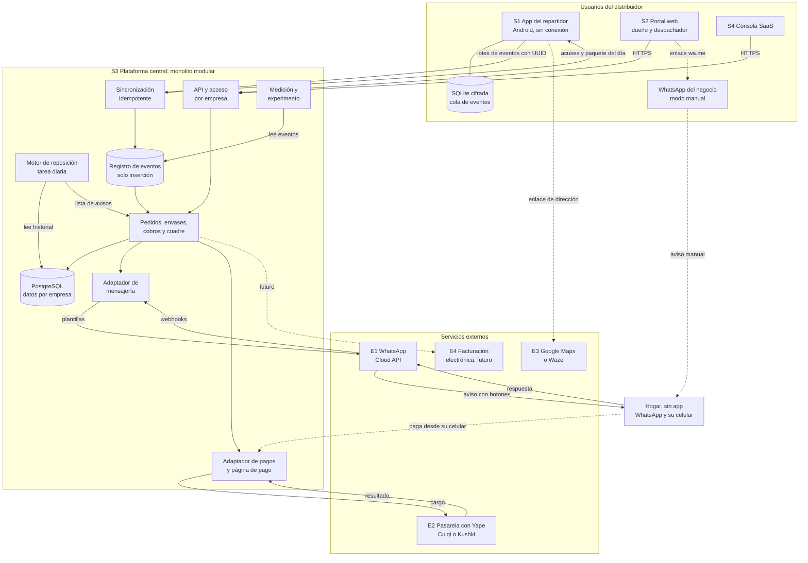
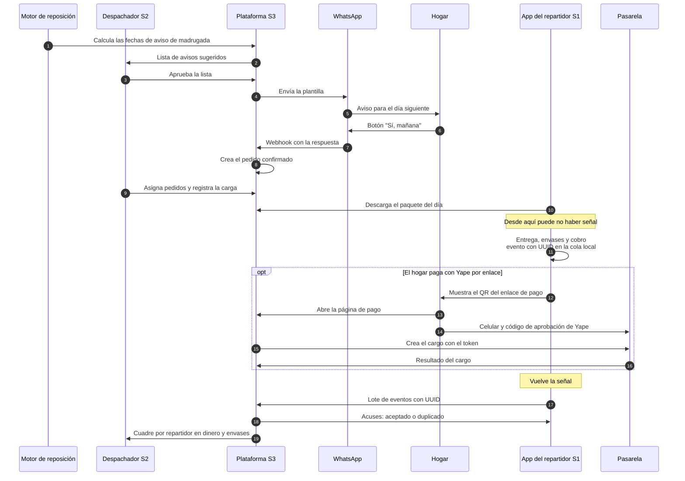

# 15 — Diagrama de arquitectura (P5-V6)

**Fecha:** 06/11/2026. Complementa `14_analisis_funcional_y_requerimientos.md` y actualiza para la V6 el esquema de `06` §2. Los sistemas S1–S4 y E1–E4 son los de `14` §3.

## 1. Cómo se conectan los sistemas

Líneas continuas: conexiones del sistema. Líneas punteadas: enlaces que abre una persona (WhatsApp manual, mapas, página de pago) o integraciones futuras.

**Lectura:**

- **El hogar no instala nada.** Recibe el aviso por WhatsApp: en el MVP, desde el celular del negocio mediante un enlace `wa.me`; en el piloto, por la API con botones. También paga desde su propio celular.
- **La app del repartidor escribe primero en su base local.** Cuando hay señal, envía lotes de eventos con UUID; el servidor los acepta una sola vez y devuelve acuses (`14` RF-SYN).
- **El registro de eventos es la fuente de verdad.** Pedidos, saldo de envases, cobros y cuadre se calculan a partir de él.
- **El motor de reposición es una tarea diaria** que lee el historial y deja la lista de avisos para que el despachador la apruebe (`14` RF-REP-05).
- **WhatsApp y la pasarela entran por adaptadores.** Se puede pasar del modo manual a la API, o de Culqi a Kushki, sin tocar el resto.

## 2. Flujo principal: del aviso al cuadre

**En el MVP, los pasos 4 a 8 son manuales.** El despachador abre cada aviso con el enlace `wa.me`, marca la respuesta en el portal y, si es "sí", el pedido se crea al marcarla (`14` RF-REP-06). El resto del flujo no cambia.

## 3. Conexiones

| Origen → destino | Qué viaja | Protocolo | ¿Funciona sin señal? |
|---|---|---|---|
| S1 → S3 | Lotes de eventos con UUID | HTTPS, JSON, token del dispositivo | Sí: se guardan en la cola y se envían después |
| S3 → S1 | Paquete del día, acuses y cambios | HTTPS | Se descarga al empezar la jornada |
| S2 → S3 | Operación del local | HTTPS, sesión de usuario | No: el local necesita internet |
| S2 → WhatsApp del negocio | Aviso con el texto ya escrito (modo manual) | Enlace `wa.me` | — |
| S3 → E1 | Plantillas | HTTPS (Cloud API) | — |
| E1 → S3 | Respuestas y estados | Webhook verificado por firma | — |
| Hogar → S3 y E2 | Pago | Página de pago con el checkout de la pasarela | Usa la señal del hogar, no la del repartidor |
| S3 ↔ E2 | Cargo y resultado | HTTPS con llave privada; webhooks [PI] | — |
| S1 → E3 | Dirección | Enlace a la app de mapas | Depende de la app de mapas |

## 4. Decisiones de arquitectura

| Decisión | Por qué |
|---|---|
| Monolito modular, no microservicios | Equipo de dos personas; mismo criterio que `../../sistema-pagos-biometricos-cerrado/05_arquitectura_y_seguridad.md` §2.1 |
| Registro de eventos de solo inserción como fuente de verdad | El cuadre y el saldo de envases son sumas auditables (`06` §1) |
| Adaptadores para WhatsApp y pagos | Cambiar de proveedor o de modo sin tocar el dominio |
| Motor de reposición como tarea diaria sobre PostgreSQL | Son medianas por hogar: no hace falta infraestructura de aprendizaje automático |
| La app no maneja datos de Yape | Evita la exigencia de PCI DSS SAQ-D de la API directa (`14` F3) |
| Tecnologías | Las de `06` §2: Flutter o React Native con SQLite; NestJS o Spring con PostgreSQL. Si el equipo ya usa .NET, como en el proyecto cerrado, ASP.NET Core también sirve |

## 5. Reutilización en la suite para distribuidoras

La app S1, la sincronización y el registro de eventos son el mismo núcleo que el módulo M2 (preventa y reparto sin conexión) de `../iteracion-2_01_integraciones_y_suite_distribuidoras.md` §2.4. Para la suite cambian el cliente atendido (bodegas en vez de hogares) y el catálogo, que pasa a ser multimarca.
