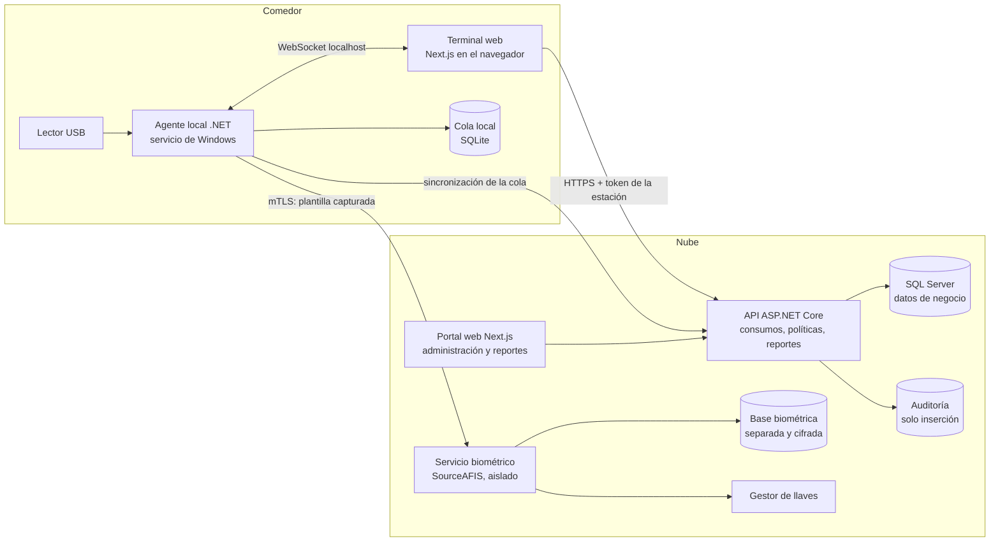
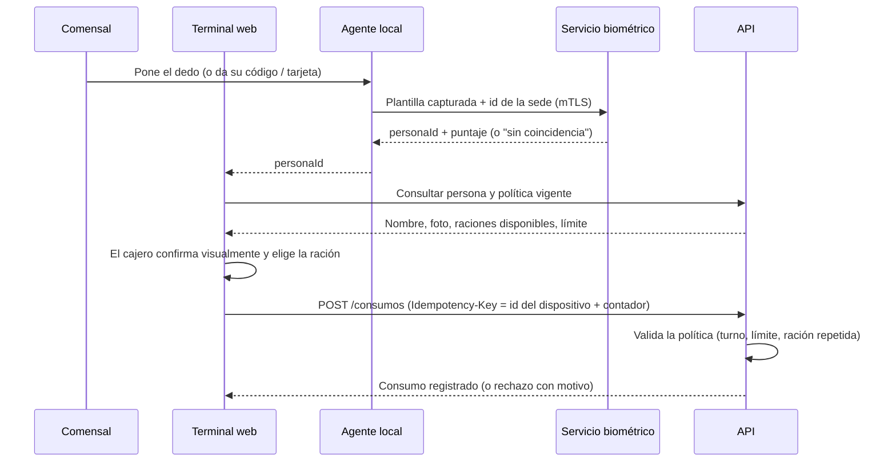
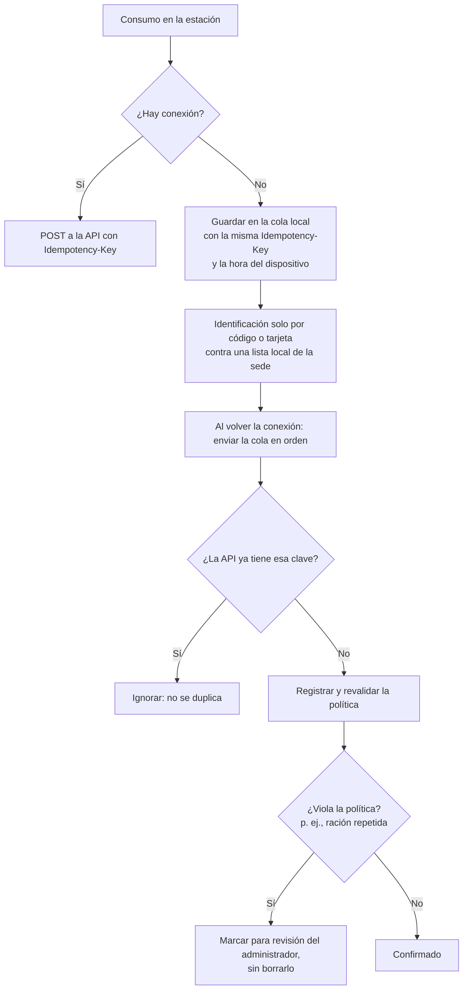
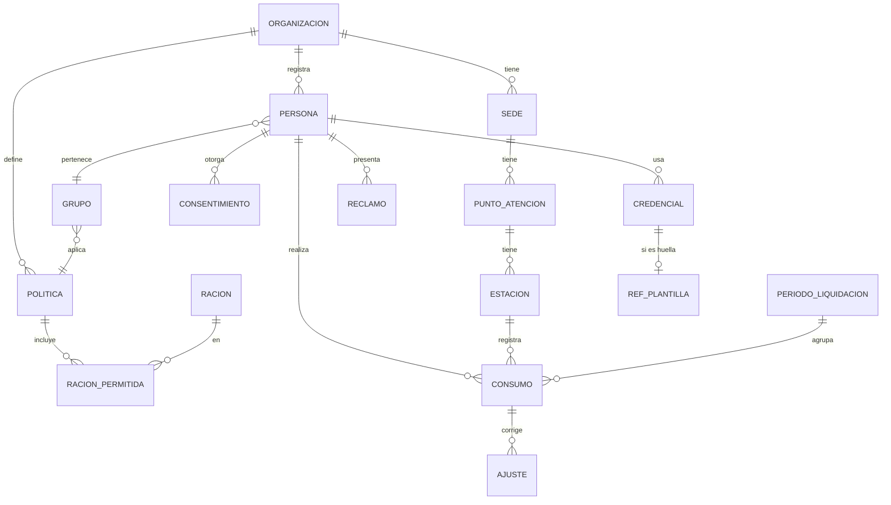

# 05 — Arquitectura y seguridad

**Fecha:** 27/10/2026. Etiquetas y fuentes en `10_fuentes_y_evidencias.md`.

**Principio de diseño:** el producto es un **sistema de registro de consumos y conciliación con varias credenciales**. La huella es **una credencial opcional**, no el centro. Así lo exigen la ley (`06` §3) y la competencia (`01` §4).

**El sistema no procesa pagos, no custodia dinero y no maneja saldos prepagados.** Registra consumos que el cliente cobra con sus propios mecanismos (modelo pospago de `ref-11` §1.1).

## 1. ¿POS propio, integración o solo capa de consumos?

| Opción | Descripción | Ventajas | Desventajas | Decisión |
|---|---|---|---|---|
| A. POS completo (ventas, caja, boletas) | Competir con los POS de restaurante | Producto "todo en uno" | Facturación electrónica SUNAT, caja, inventario: mucho alcance y fuera del problema | **No** |
| B. Integración con un POS existente | El POS cobra y el sistema identifica a la persona y atribuye el consumo | Aprovecha lo que el cliente ya tiene | Cada POS es distinto; no hay APIs públicas verificadas | **Más adelante** (por demanda) |
| **C. Capa de identificación y registro de consumos** | Catálogo simple de raciones con precio opcional, registro, límites y reportes | Resuelve P1 y P5–P8 de `03`; alcance acotado | No cobra; el cliente factura o descuenta aparte | **Sí: MVP** |

## 2. Componentes



**Explicación:**
- **El terminal web** (Next.js) es la pantalla del cajero: busca a la persona, muestra nombre y foto, y registra el consumo.
- **El agente local** es necesario porque el navegador no puede leer el lector (`04` §2). También guarda la cola sin conexión.
- **El servicio biométrico está aislado**, con su propia base y su propia llave. La API de negocio nunca ve plantillas: solo recibe "persona X verificada, puntaje Y".
- **La auditoría es de solo inserción.** Las correcciones se registran como movimientos nuevos, nunca como ediciones.

### 2.1 ¿El stack propuesto es adecuado?

| Elemento | Evaluación |
|---|---|
| Next.js + Tailwind | Adecuado para el portal y el terminal. El terminal podría ser una página más simple; no hace falta renderizado en servidor |
| ASP.NET Core | Adecuado. Ventaja: el mismo lenguaje que el agente local y SourceAFIS (.NET) |
| SQL Server + EF Core | Adecuado. Para el TSP alcanzan las ediciones gratuitas (verificar la licencia de SQL Server Express o Developer para producción) |
| Agente local en .NET | Necesario. El SDK de Windows de los lectores encaja con .NET (DC [F30]) |
| Cola local | SQLite es más simple que SQL Server en la estación (I) |

**Conclusión:** el stack es apropiado. No hace falta añadir más tecnologías (colas de mensajes, microservicios) en el MVP. Un **monolito modular** más el servicio biométrico separado es suficiente.

## 3. Flujos principales

### 3.1 Registro de un consumo (en línea)



- La **política** (una ración por turno, límite mensual, subsidio) se valida en el servidor, no en la estación.
- Si la huella falla una vez, el terminal ofrece **inmediatamente** el código o la tarjeta.

### 3.2 Registro de la persona y consentimiento

```mermaid
sequenceDiagram
    participant P as Persona
    participant O as Operador de registro
    participant ADM as Portal
    participant B as Servicio biométrico
    P->>O: Llega al registro (lista importada por el cliente)
    O->>P: Explica la finalidad, la alternativa sin huella y sus derechos (texto del art. 6.1 del DS)
    alt Acepta la huella
        P->>ADM: Firma el consentimiento escrito (firma electrónica o manuscrita escaneada)
        ADM->>ADM: Guarda la evidencia del consentimiento (versión del texto, fecha, firma)
        O->>B: Captura 2 dedos × 3 muestras; mide la calidad
        B->>B: Guarda solo plantillas cifradas
    else No acepta o la huella no sirve
        ADM->>ADM: Asigna un código personal y/o una tarjeta
    end
```

### 3.3 Funcionamiento sin conexión y sincronización



- Sin conexión **no se usa la huella** en el MVP: las plantillas no se guardan en la estación (`04` §7, opción 1).
- La lista local de la sede contiene solo el código, el nombre y la foto de las personas activas, cifrada en el disco.

## 4. Modelo de datos conceptual



| Entidad | Atributos clave | Notas |
|---|---|---|
| Organización | id, RUC, tipo (empresa / concesionario / universidad) | Separa los datos de cada cliente (*tenant*) |
| Organización cliente del concesionario | id, organizaciónId (concesionario), empresa atendida | Para la facturación por empresa (D1 de `01`) |
| Persona | id, organizaciónId, código, nombre, foto, estado (activa / baja), fechaBaja | **Sin DNI completo** salvo que el cliente lo necesite (minimización) |
| Credencial | tipo (código / tarjeta / QR / huella), valor o referencia, estado | La huella solo guarda una referencia; la plantilla vive en la base biométrica |
| Plantilla (base biométrica) | id, refId, dedo, plantilla cifrada, versión del algoritmo, calidad | Base y llave separadas; **sin imágenes** |
| Consentimiento | personaId, versión del texto, fecha, medio, evidencia de firma, fecha de revocación | La carga de la prueba es del responsable (art. 9 del DS) [C16] |
| Política / grupo | raciones por turno, límite mensual, % de subsidio de la empresa | Lo que el cliente "configura" |
| Ración | nombre, precio (opcional), vigencia | Precio con vigencia para no alterar el pasado |
| Consumo | id, idempotencyKey (única), personaId, estaciónId, raciónId, monto, subsidio, horaDispositivo, horaServidor, método de identificación, puntaje | **Inmutable** |
| Ajuste | consumoId, tipo (anulación / corrección), motivo, usuario, fecha | Corrige sin borrar |
| Período de liquidación | organización, desde, hasta, estado (abierto / cerrado / exportado) | Un período cerrado no admite consumos nuevos, solo ajustes en el siguiente |
| Reclamo | personaId, consumoId, texto, estado, respuesta | Canal para el usuario final |
| Evento de auditoría | actor, acción, entidad, antes/después (hash), fecha | Solo inserción |

## 5. Requisitos transversales

| Tema | Diseño |
|---|---|
| **Autenticación y autorización** | Usuarios del portal con OIDC (proveedor administrado o ASP.NET Identity) y MFA para administradores. Roles: administrador de la organización, supervisor de comedor, cajero, auditor, soporte de la plataforma (acceso de soporte registrado y temporal). Estaciones con certificado propio (mTLS) y token de dispositivo |
| **Separación de organizaciones** | `OrganizacionId` en todas las tablas + filtro global de EF Core + pruebas automáticas de aislamiento. Una base por cliente solo si un contrato lo exige |
| **Trazabilidad** | Cada consumo guarda el método de identificación, el puntaje, la estación, el cajero y las dos horas (dispositivo y servidor) |
| **Idempotencia** | Clave única por consumo generada en la estación (id del dispositivo + contador monotónico). Índice único en la base |
| **Anulaciones y correcciones** | Siempre como `Ajuste` con motivo; el consumo original no cambia. Si el período ya está cerrado, el ajuste va al siguiente |
| **Duplicados** | La política "una ración por turno" se valida en el servidor; los duplicados sin conexión se marcan para revisión (§3.3) |
| **Auditoría** | Tabla de solo inserción con hash encadenado (I: evita modificaciones silenciosas); se exporta para el cliente |
| **Plantillas biométricas** | Base separada; cifrado de cada plantilla con una llave de un gestor de llaves (KMS); el servicio biométrico es el único con permiso; sin imágenes; borrado al dar de baja, revocar o terminar el contrato |
| **Cifrado** | TLS en tránsito; cifrado en reposo de las bases; llaves rotables |
| **Copias de seguridad** | Diarias, cifradas, con prueba de restauración mensual. Las copias de la base biométrica deben respetar el borrado: retención corta y documentada (I) |
| **Sin conexión** | Cola local + lista de la sede (§3.3) |
| **Integraciones** | MVP: exportación CSV o Excel por período para planilla y facturación. Luego, API REST con webhooks para POS o ERP |
| **Escalabilidad y costos** | El volumen es bajo (cientos a miles de consumos por sede al día, E). Un servicio de aplicaciones y una base administrada pequeña alcanzan para el MVP. Costos de nube: **ND**, cotizar |
| **Dependencia del hardware** | Interfaz `IIdentificationDevice` con adaptadores por fabricante; plantillas en formato ISO 19794-2 cuando el SDK lo permita, para poder cambiar de comparador |
| **Ubicación de los datos** | Si la nube está fuera de Perú hay **flujo transfronterizo**: obligaciones del art. 15 de la Ley y comunicación a la Autoridad (ver `06` §2) [C15, C16] |

## 6. Contingencias pedidas

| Situación | Qué hace el sistema |
|---|---|
| La persona no tiene huella legible | El registro mide la calidad; si falla, se le asigna un código o una tarjeta. Queda como "huella no apta", sin juicio ni penalización |
| El lector falla o no está | La estación cambia a código o tarjeta; alerta al supervisor |
| La persona no quiere dar su huella | Código o tarjeta **con el mismo servicio**. El sistema no muestra ni reporta quién eligió la alternativa a otros roles que no lo necesiten |
| Hay que corregir un consumo | El supervisor crea un `Ajuste` con motivo; queda auditado |
| Hay que anular una transacción | Igual: un ajuste de anulación; nunca un borrado |
| Consumos duplicados o incorrectos | Detección por idempotencia y por política; cola de revisión del administrador |
| Un trabajador deja la empresa o un estudiante egresa | El cliente marca la baja (o se importa desde su sistema); las credenciales se desactivan; **las plantillas se borran automáticamente** y queda constancia. Los consumos históricos se conservan solo el plazo que defina el cliente (contable o laboral) |
| Se pierde internet | Cola local + identificación por código o tarjeta (§3.3) |
| El usuario consulta sus consumos o reclama | Portal o vista de solo lectura del usuario (fase 2); en el MVP, reporte individual a pedido + registro de reclamos por el administrador. Los plazos de respuesta ARCO del DS (8, 20 o 10 días según el derecho) los cumple el cliente con ayuda del sistema [C16] |

## 7. MVP y fases

| Funcionalidad | MVP | Fase 2 | Fase 3 |
|---|---|---|---|
| Organizaciones, sedes, estaciones (multiempresa) | ✔ | | |
| Importación de personas (CSV) y bajas | ✔ | Sincronización con RR. HH. por API | |
| Credenciales: código + tarjeta o QR | ✔ | | |
| Credencial de huella (1:1 con código, y 1:N por sede) | ✔ (opcional por organización) | | Rostro o huella sin contacto |
| Consentimiento escrito, revocación y borrado | ✔ | | |
| Políticas: raciones por turno, límite | ✔ | Subsidio porcentual, topes por grupo | |
| Registro de consumos con idempotencia | ✔ | | |
| Ajustes (anulación y corrección) con auditoría | ✔ | | |
| Cola sin conexión | ✔ | Huella sin conexión (caché cifrada), solo si hay demanda | |
| Reportes y exportación por período | ✔ | Facturación por empresa cliente del concesionario | |
| Portal del usuario final y reclamos | Registro por el administrador | ✔ | |
| Integración con POS o ERP | | Por demanda | ✔ |
| Panel de indicadores (colas, desperdicio) | | ✔ | |

## 8. Seguridad: amenazas principales

| Amenaza | Control |
|---|---|
| Filtración de la base biométrica | Base y llave separadas; cifrado por plantilla; sin imágenes; acceso mínimo; registros de acceso; plan de incidentes de 48 h (art. 34 del DS) [C16] |
| Estación robada | Sin plantillas en la estación (MVP); lista local cifrada; certificado revocable |
| Cajero que registra consumos falsos | Cada consumo exige una identificación registrada (método y puntaje); los consumos manuales se marcan y se reportan |
| Suplantación con un dedo falso | Riesgo bajo en un comedor (el beneficio es una ración, I); cajero presente; lector con detección de dedo vivo si el cliente lo exige |
| Acceso de una organización a datos de otra | Filtros por *tenant* + pruebas automáticas |
| Personal de soporte de la plataforma | Acceso temporal, aprobado y auditado |
