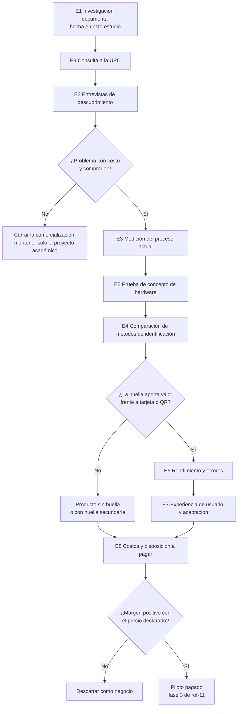

# 09 — Plan experimental y matriz de riesgos

**Fecha:** 27/10/2026. Etiquetas y fuentes en `10_fuentes_y_evidencias.md`.

Los umbrales que aparecen son **criterios de diseño por validar**. Cada uno indica por qué se eligió. No son normas ni datos de mercado.

## 1. Etapas y puertas de decisión

**Explicación:**
- El orden pone primero lo **barato y decisivo**: la UPC y las entrevistas.
- G1 puede detener la comercialización sin escribir código de producto.
- G2 decide el papel de la huella con datos, no por preferencia.

## 2. Experimentos

### E1 — Investigación documental y de competidores

| Campo | Contenido |
|---|---|
| Hipótesis | Existen soluciones que ya resuelven el problema |
| Estado | **Realizado** en esta investigación (`01`, `10`) |
| Resultado | Confirmada: GeoVictoria Control de Comedor en Perú [C1]; ZKTeco [C5]; CBORD en EE. UU. [C6] |
| Decisión | Continuar, **cambiando** la propuesta de valor (`01` §4) |

### E2 — Entrevistas de descubrimiento

| Campo | Contenido |
|---|---|
| Hipótesis | H1–H3 de `ref-11` y P1–P10 de `03`: al menos uno de los problemas tiene un costo concreto para un comprador identificable |
| Objetivo | Confirmar o refutar el problema, el comprador y las soluciones actuales |
| Muestra | 15–20 entrevistas: ≥ 5 concesionarios, ≥ 5 empresas con comedor (RR. HH. u operaciones), ≥ 3 universidades, ≥ 5 usuarios finales. **Justificación:** con 5 entrevistas por tipo de actor suelen aparecer patrones repetidos en estudios cualitativos (I) |
| Procedimiento | Guías de `03` §3; sin presentar la solución; grabación con consentimiento; codificación de hechos |
| Métricas | N.º de organizaciones con el problema y su costo; soluciones actuales; disposición a un piloto |
| Instrumentos | Guía semiestructurada; matriz de codificación |
| Éxito | ≥ 3 organizaciones con costo concreto y ≥ 2 dispuestas a un piloto con pago o carta de intención (`03` §4) |
| Fracaso | < 3 organizaciones con problema, o todas satisfechas con su solución actual |
| Riesgos | Sesgo de cortesía; acceso difícil; **requiere autorización para contactar** |
| Decisión | Éxito → E3. Fracaso → cambiar de segmento una vez; si falla de nuevo, cerrar la comercialización |

### E3 — Medición del proceso actual

| Campo | Contenido |
|---|---|
| Hipótesis | Hay colas, errores o tiempos de conciliación medibles (P3, P7) |
| Objetivo | Obtener una línea base |
| Muestra | 2–3 comedores, 3 días cada uno, en hora punta |
| Procedimiento | Cronometrar el tiempo por persona y la longitud de la cola; pedir el tiempo de conciliación mensual (registro de horas del responsable) |
| Métricas | Tiempo por persona (mediana, p95); personas por minuto; horas de conciliación al mes; errores o correcciones al mes |
| Instrumentos | Cronómetro, hoja de registro, entrevista |
| Éxito | Línea base obtenida en ≥ 2 comedores |
| Fracaso | No se obtiene acceso. **No invalida la idea**; debilita la justificación |
| Riesgos | Efecto observador; variabilidad entre días |
| Decisión | Insumo para E4 y E8 |

### E4 — Comparación de métodos de identificación

| Campo | Contenido |
|---|---|
| Hipótesis | La huella (1:N por sede) es al menos tan rápida como la tarjeta o el QR, y reduce el préstamo |
| Objetivo | **Decidir con datos si la huella aporta valor** frente a lo más simple y menos invasivo |
| Muestra | ≥ 20 participantes × 4 métodos (huella 1:N, huella 1:1 con código, tarjeta o QR, código + foto) × ≥ 5 repeticiones, en un comedor simulado |
| Procedimiento | Orden de los métodos aleatorizado por participante; cola simulada; registro automático de tiempos |
| Métricas | Tiempo por persona (mediana, p95); tasa de fallo al primer intento; tasa de error de atribución; preferencia declarada |
| Instrumentos | Registros del sistema; cuestionario |
| Éxito | La huella no es más lenta que la tarjeta (diferencia de mediana ≤ 1 s, umbral de diseño: por debajo de esa diferencia es poco perceptible en una cola, I) y es preferida o neutral |
| Fracaso | La huella es más lenta o falla con más frecuencia que la tarjeta |
| Riesgos | Laboratorio ≠ comedor real; participantes jóvenes con huellas en buen estado |
| Decisión | Éxito → huella como opción destacada. Fracaso → huella secundaria o eliminada |

### E5 — Prueba de concepto de hardware

| Campo | Contenido |
|---|---|
| Hipótesis | Un lector comercial con SDK se integra con .NET y la web mediante un agente local |
| Objetivo | Viabilidad técnica antes de construir el producto |
| Muestra | 2 lectores (p. ej., SecuGen y ZK9500); 10–20 voluntarios con consentimiento |
| Procedimiento | PoC-1 a PoC-5 de `04` §9 |
| Métricas | Captura estable; tiempo de captura y comparación; 0 duplicados con cortes de red |
| Instrumentos | Registros del agente y del servicio |
| Éxito | PoC-1 a PoC-4 superadas con al menos un lector |
| Fracaso | Ningún lector se integra de forma estable |
| Riesgos | Documentación de SDK deficiente [F33] |
| Decisión | Fracaso → replantear el alcance biométrico del TSP |

### E6 — Rendimiento y errores biométricos

| Campo | Contenido |
|---|---|
| Hipótesis | El comparador alcanza un FNMR bajo con un FMR estricto en galerías por sede |
| Objetivo | Medir FMR, FNMR, FTE y tiempos en 1:1 y 1:N |
| Muestra | Base pública (verificar la licencia) y/o 20–40 voluntarios × 2 dedos × 2 sesiones separadas ≥ 1 semana |
| Procedimiento | Según el marco de ISO/IEC 19795-1 (como referencia, sin afirmar cumplimiento); comparaciones genuinas e impostoras; galerías simuladas N = 50, 100, 500 |
| Métricas | FNMR y FMR en el umbral elegido (intervalo de Wilson al 95 %); tasa de falsa identificación frente a N; FTE; tiempo de comparación |
| Instrumentos | Scripts de evaluación; curva DET |
| Éxito | Se reportan todas las métricas con intervalos. Objetivo de diseño: FNMR ≤ 2 % con hasta 3 intentos, el mismo objetivo de campo de `ref-11` |
| Fracaso | FTE alto (p. ej., > 5 %) o FNMR que obligaría a muchos reintentos en una cola |
| Riesgos | Muestra pequeña: solo pueden afirmarse tasas del orden de 10⁻² a 10⁻³ (regla del 3) |
| Decisión | Fracaso → recomendar 1:1 con código o una alternativa (rostro) como trabajo futuro |

### E7 — Experiencia de usuario y aceptación

| Campo | Contenido |
|---|---|
| Hipótesis | Cajeros y comensales encuentran el sistema usable; una parte significativa elige la huella si puede elegir |
| Objetivo | Medir la usabilidad y la aceptación voluntaria |
| Muestra | Participantes de E4 + ≥ 3 cajeros (reales o simulados) |
| Procedimiento | Tareas guiadas; SUS; pregunta de elección real: "¿Quiere registrar su huella o prefiere tarjeta o código?" |
| Métricas | SUS (objetivo ≥ 68, promedio de referencia de la escala); % que elige la huella; motivos de rechazo |
| Instrumentos | Cuestionario SUS; registro de la elección |
| Éxito | SUS ≥ 68 y ≥ 50 % elige la huella (umbral de diseño: por debajo, el costo de mantener la huella pesa más que su uso, I) |
| Fracaso | La mayoría no elige la huella |
| Riesgos | Sesgo de novedad; participantes universitarios ≠ trabajadores |
| Decisión | Fracaso → huella secundaria |

### E8 — Costos y disposición a pagar

| Campo | Contenido |
|---|---|
| Hipótesis | El precio aceptado cubre el costo de servir cada sede (`07` §4) |
| Objetivo | Reemplazar las variables de `07` con datos |
| Muestra | Organizaciones de E2 con el problema confirmado |
| Procedimiento | Segunda entrevista con la demostración; preguntas de `03` §3.8; propuesta de piloto pagado |
| Métricas | Precio aceptado por sede; horas de instalación y soporte estimadas; costo actual del problema (V) |
| Instrumentos | Entrevista; propuesta formal |
| Éxito | ≥ 2 pilotos con pago o carta de intención; margen por sede positivo con el precio aceptado |
| Fracaso | Solo aceptan si es gratis |
| Riesgos | Lo declarado ≠ lo real; por eso se pide un pago simbólico |
| Decisión | Éxito → piloto (fase 3 de `ref-11`). Fracaso → descartar como negocio |

### E9 — Validación del alcance del TSP

| Campo | Contenido |
|---|---|
| Hipótesis | La UPC acepta el proyecto como TSP independiente, en pareja |
| Objetivo | Confirmar la modalidad antes de desarrollar |
| Muestra | Coordinación de la carrera y asesor |
| Procedimiento | Preguntas de `../sistema-pagos-biometricos-general/investigacion_pagos_biometricos/07_viabilidad_tsp_upc.md` §1 + presentación del título y los objetivos de `08` §4 |
| Métricas | Respuesta escrita |
| Éxito | Aceptación como TSP |
| Fracaso | No se acepta |
| Riesgos | Respuesta tardía |
| Decisión | Fracaso → tesis con el mismo contenido |

## 3. Cronograma orientativo

| Semanas | Actividad |
|---|---|
| 1 | E9 (UPC); preparar las guías de E2; pedir autorizaciones |
| 1–6 | E2 (entrevistas) en paralelo |
| 2–4 | E5 (prueba de concepto) |
| 4–6 | E3 (medición en comedores con acceso) |
| **6** | **Puerta G1** |
| 5–12 | Desarrollo del MVP (`08` §7) |
| 12–14 | E4, E6, E7 |
| **14** | **Puerta G2** |
| 13–15 | E8 (segunda ronda con la demostración) |
| **15** | **Puerta G3** |
| 15–18 | Informe y sustentación |

## 4. Matriz de riesgos

Probabilidad (P) e impacto (I): B = baja, M = media, A = alta.

| # | Riesgo | P | I | Evidencia actual | Mitigación | Experimento |
|---|---|---|---|---|---|---|
| R1 | No hay un problema comercial suficientemente importante | M | A | Hay mercado para el control de raciones [C1], pero no hay datos de costo en Perú | Descubrimiento antes de desarrollar | E2, E3 |
| R2 | Baja disposición de pago | M-A | A | El competidor no publica precios [C3]; los márgenes de los concesionarios son desconocidos | Piloto con pago simbólico | E8 |
| R3 | Competidores consolidados | **A** | A | GeoVictoria ofrece el mismo flujo con huella o rostro en Perú [C1]; ZKTeco [C5] | Diferenciación D1/D2 (`01` §4); segmento de concesionarios | E2, E8 |
| R4 | Dificultad para acceder a los compradores | M-A | A | Venta consultiva [C3]; concesionarios grandes corporativos [C8, C9] | Empezar por concesionarios medianos; referidos | E2 |
| R5 | Hardware costoso o difícil de integrar | B-M | M | Lectores de S/ 199–209 [F33]; SDK irregular en algunos fabricantes [F33] | 2 lectores; capa de abstracción | E5 |
| R6 | Dependencia de un SDK propietario | M | M | SDK cerrados [F30–F33] | `IIdentificationDevice`; ISO 19794-2; SourceAFIS [F34] | E5 |
| R7 | Falsos rechazos y problemas operativos | M-A | A | Fallos del 15–20 % en trabajadores manuales (anecdótico) [C14]; huellas deterioradas en Perú [F35] | Alternativa inmediata; 2 dedos; medir el FTE; evitar segmentos manuales al inicio | E6, E4 |
| R8 | Riesgos de privacidad y seguridad (filtración irrevocable) | B-M | **Muy A** | Datos sensibles (Ley art. 2.5) [C15]; incidentes en 48 h (DS art. 34) [C16] | Base y llave separadas; sin imágenes; borrado automático; pentest | Revisión de seguridad + E5 |
| R9 | Consentimiento inválido por falta de libertad (relación laboral) | M | A | DS art. 3.2 [C16]; criterio de Ecuador [C20] | Huella opcional con una alternativa equivalente; opinión legal | Opinión legal (`06` §7) |
| R10 | Rechazo de los usuarios a la biometría | M | M-A | Sin datos de Perú; en el Reino Unido se ofrece una alternativa [C7] | Transparencia; opcional | E7 |
| R11 | Falta de una alternativa accesible para quien no usa biometría | B (si se diseña bien) | A | Es una exigencia legal [C16] | Código, tarjeta o QR desde el MVP | Pruebas del MVP |
| R12 | Integración con sistemas existentes (planilla, POS, ERP) | M | M | Sin APIs públicas verificadas | Exportación CSV en el MVP; API después | E2 (pregunta a TI) |
| R13 | Complejidad excesiva para el TSP | M | A | Alcance amplio | MVP de `05` §7; congelar el alcance; el núcleo no depende de la huella | E9 + planificación |
| R14 | Costos de implementación y soporte por sede | M | A | ND; es el factor clave de `07` §4.1 | Medir las horas en el piloto; instalación estandarizada | E8 + piloto |
| R15 | Dependencia de la conectividad | M | A | El Box Comedor no documenta modo sin conexión [C1]; zonas remotas | Cola local; identificación sin conexión por código o tarjeta | E5 (PoC-4) |
| R16 | La UPC no acepta el proyecto como TSP | M (desconocida) | A | Otras universidades exigen experiencia [C22, F40] | Consulta en la semana 1; plan B: tesis | E9 |
| R17 | El producto termina siendo "empresa administradora" de vales (Ley 28051) o maneja dinero | B | A | Modalidad indirecta con registro en el MTPE [C18]; Circular BCRP [F5] | Mantener la modalidad directa y el modelo pospago | Opinión legal |
| R18 | Uso de datos de menores | B (si se excluyen colegios) | A | DS art. 22 [C16]; AEPD y CNIL [C20] | Excluir el segmento | — |

**Riesgos que por sí solos invalidan la idea comercial:**
1. **R3 + R2:** si el competidor instalado resuelve lo mismo y el cliente no paga por una diferencia.
2. **R1:** si el problema no tiene un costo que justifique el cambio.
3. **R9:** si un abogado concluye que la huella no es defendible ni siquiera como opción en el ámbito laboral. En ese caso el producto quedaría sin huella (otra propuesta).
