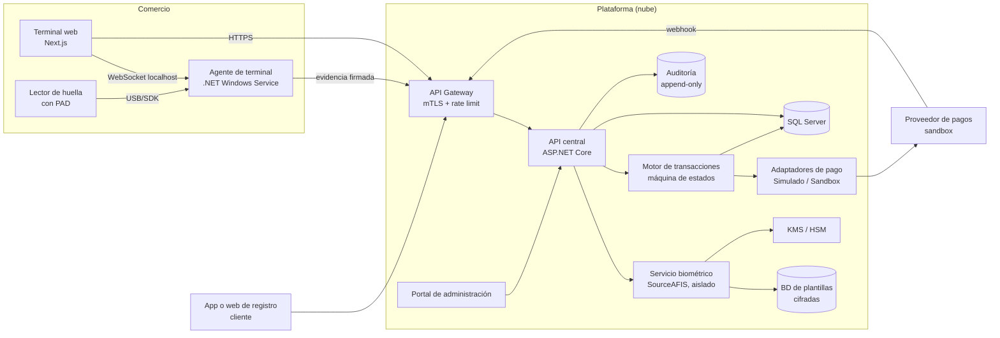
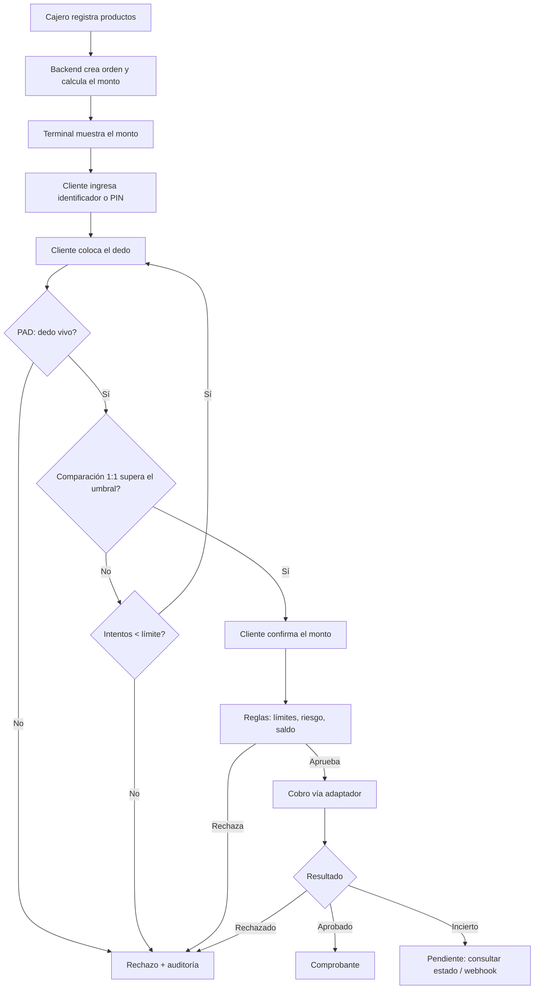
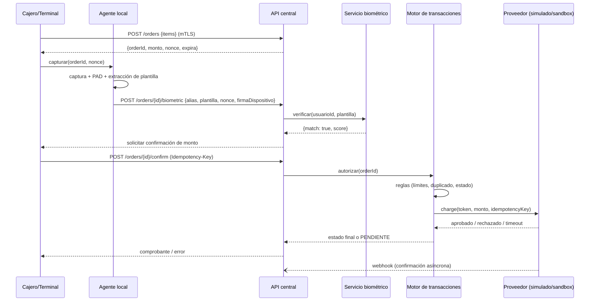
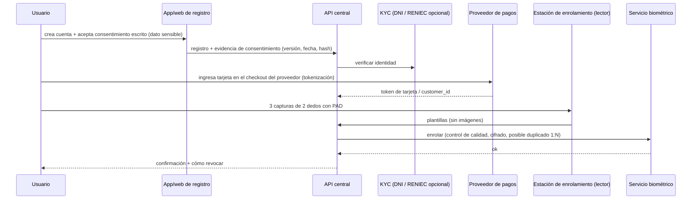

# 03 — Viabilidad técnica y arquitectura

## 1. Comparación de modalidades biométricas

Hechos con fuente marcados `[Fxx]`; el resto es **análisis del investigador (I)**.

| Criterio | Huella | Venas del dedo | Rostro | Palma (venas) |
|---|---|---|---|---|
| Costo del sensor | Bajo: US$ 70–200 [F30, F31, F33] | Alto (lector especializado, p. ej. Hitachi) — I | Bajo (webcam), pero el PAD robusto es caro | Alto (sensor Fujitsu) [F18] |
| Disponibilidad en Perú | Alta (ZKTeco en Falabella) [F33] | Baja — I | Alta | Baja |
| Integración | SDK maduros y SourceAFIS en C# [F34] | SDK cerrados | Modelos abiertos (OpenCV) | SDK cerrados |
| Suplantación | Moldes de silicona, gelatina o látex; requiere PAD [F32] | Más difícil (vasos internos) — I | Fotos, video, máscaras; NIST **exige** PAD [F9] | Difícil — I |
| Dedos húmedos, sucios o gastados | **Problema real**: en Perú hay trámites especiales en RENIEC para huellas deterioradas [F35] | Menos sensible — I | No aplica | Menos sensible — I |
| Higiene | Contacto | Contacto | Sin contacto | Sin contacto (palma) |
| Lo eligen las redes de tarjetas para POS | No | Pilotos (Sthaler/Worldpay) [F14] | Sí (Mastercard, PopID) [F18, F19] | Sí (Mastercard, Visa/Handwave, Amazon) [F18, F26] |
| Idoneidad para el TSP | **Alta** (barato y medible) | Media | Alta (pero la decisión fue no usar rostro) | Baja (costo) |

**Conclusión:** la **huella** es la mejor opción **para el prototipo académico** por costo, SDK y facilidad de medición. Para un producto comercial, la tendencia del mercado de pagos presenciales va hacia **palma y rostro sin contacto**, no hacia la huella. Este riesgo debe declararse en la tesis.

**Precisión declarada vs. demostrable:**
- Los valores del fabricante (p. ej. "1 en 90 mil millones" de Liquid con 3 dedos [F15]) **no** se pueden replicar con un prototipo.
- Con N voluntarios solo se puede estimar la FAR con resolución de aproximadamente 3/N (regla del 3). Ver `08`.

## 2. Por qué "solo el dedo" (1:N) es el punto técnico crítico

Si cada comparación tiene una tasa de falsa coincidencia `f` y hay `N` usuarios registrados, la probabilidad de que un impostor coincida con **alguien** en una búsqueda 1:N es aproximadamente:

`P(falsa coincidencia) ≈ 1 − (1 − f)^N ≈ N·f` (cuando N·f es pequeño)

| f (por comparación) | N = 1 000 | N = 10 000 | N = 100 000 |
|---|---|---|---|
| 1 en 10 000 (mínimo NIST para autenticación [F9]) | ≈ 9,5 % | ≈ 63 % | ≈ 100 % |
| 1 en 1 000 000 | ≈ 0,1 % | ≈ 1 % | ≈ 9,5 % |

(Cálculo propio; supone comparaciones independientes, lo cual es una simplificación.)

**Implicaciones de diseño:**
- **Verificación 1:1 (recomendada):** el cliente da un identificador corto (celular, últimos dígitos del DNI o un alias) o un PIN, y luego el dedo. Es lo que hace AePS (número Aadhaar + huella) [F17].
- **1:N acotado:** búsqueda solo entre los usuarios registrados **en ese comercio**, o fusión de 2 dedos (Liquid usa 2-3 [F15]).
- **NIST SP 800-63B-4:**
  - La biometría **no es un autenticador por sí sola**.
  - Debe usarse con un **autenticador físico** (algo que se tiene).
  - Recomienda la comparación **local**.
  - Limita a 5 los intentos fallidos consecutivos (10 con PAD).
  - [F9]

## 3. Respuestas a las preguntas de arquitectura

1. **¿Puede una aplicación web acceder de forma segura al lector?**
   No directamente de forma fiable. Los SDK son nativos (Windows/Linux/Android). WebUSB no es una vía soportada por los fabricantes revisados. SecuGen ofrece una **WebAPI** que funciona mediante un servicio local [F30].
2. **¿Se necesita un agente local?**
   **Sí.** Un **Agente de Terminal** (servicio Windows en .NET) que:
   - expone `https://localhost` o WebSocket al frontend Next.js;
   - captura, extrae la plantilla y firma la solicitud con una clave del dispositivo.
3. **¿Dónde comparar?**
   - Con 1:1, la comparación puede hacerse en el **backend**, en un servicio biométrico aislado. La plantilla de referencia nunca sale hacia el terminal.
   - La alternativa más privada es comparar en el **terminal** contra una plantilla cifrada que se descarga temporalmente. Así lo recomienda NIST, pero expone las plantillas al terminal.
   - Para el TSP: **servicio biométrico en el backend**, separado de la API de pagos.
4. **¿1:N o 1:1?**
   1:1 con identificador o PIN, por la sección 2. El 1:N puro puede ser un **experimento comparativo** del TSP.
5. **¿Cómo evitar una base central con plantillas recuperables?**
   - Plantillas **cifradas** (AES-GCM) con clave en un KMS/HSM y separación de funciones.
   - **Biometría cancelable / protección de plantillas** (ISO/IEC 24745): transformación irreversible y revocable.
   - **Match-on-card / match-on-device** (tarjeta biométrica [F23]).
   - **Nunca** guardar imágenes.
6. **¿Cómo vincular la identidad con el medio de pago?**
   - Registro con KYC (DNI, y opcionalmente verificación RENIEC [F35]).
   - Tokenización del medio de pago **por el proveedor** (el PAN nunca toca la plataforma).
   - Consentimiento escrito.
   - Asociación `Usuario ↔ PlantillaBiométrica ↔ TokenDePago` firmada y auditada.
7. **¿Cómo evitar que un terminal comprometido genere cobros?**
   - Terminal registrado con certificado de dispositivo (mTLS).
   - El importe lo **define el backend** a partir de la orden creada por el comercio, no el terminal.
   - El terminal solo envía la evidencia biométrica ligada a un `orderId` + `nonce`.
   - Límites por transacción y por día, y detección de anomalías.
8. **¿Cómo evitar el doble procesamiento?**
   - `Idempotency-Key` por orden.
   - Máquina de estados de la transacción con restricción única `(orderId)`.
   - Uso de la idempotencia del proveedor cuando exista.
9. **¿Cómo manejar errores de red y timeouts?**
   - Estados `PENDIENTE_CONFIRMACION`.
   - Consulta de estado al proveedor (o webhooks).
   - Reintentos con la misma clave de idempotencia.
   - Conciliación diaria.
   - No reintentar un cobro con resultado incierto sin consultar antes.
10. **¿Cómo resistir repetición, suplantación y manipulación de importes?**
    - `nonce` de un solo uso con expiración (≤ 60 s) firmado por el backend.
    - La evidencia biométrica se liga criptográficamente a `orderId + monto + nonce`.
    - PAD en el lector.
    - El cliente confirma el importe en la pantalla del terminal.
11. **¿Qué pasa con la revocación o el reemplazo de la huella?**
    - Borrado de la plantilla (o rotación de la transformación cancelable).
    - Revocación del vínculo con el token.
    - Registro de la solicitud ARCO.
    - Re-enrolamiento con otro dedo.
    - Ver los plazos en `05`.
12. **¿Qué arquitectura minimiza el costo multiproveedor?**
    - **Puerto/adaptador** `IPaymentProvider` (Simulado, MercadoPago, Culqi…).
    - Modelo de transacción propio y normalizado.
    - Webhooks normalizados.

## 4. Arquitectura de referencia

## 5. Flujo de compra

## 6. Diagrama de secuencia de una transacción

## 7. Registro del usuario

## 8. Modelo de datos preliminar

| Entidad | Campos principales | Notas |
|---|---|---|
| `Usuario` | Id, DocumentoHash, Nombre, Alias, PinHash, Estado | Sin datos de tarjeta |
| `Consentimiento` | Id, UsuarioId, Version, Finalidad, FechaOtorgado, FechaRevocado, EvidenciaHash | Exigido por la Ley 29733 |
| `PlantillaBiometrica` | Id, UsuarioId, Dedo, Formato, BlobCifrado, KeyId, Calidad, FechaAlta, Estado | En una BD separada; sin imágenes |
| `MedioPago` | Id, UsuarioId, Proveedor, TokenProveedor, Marca, Ultimos4, Estado | Solo el token del proveedor |
| `Comercio` | Id, RUC, Nombre, Estado | |
| `Terminal` | Id, ComercioId, CertificadoThumbprint, Estado, UltimaConexion | mTLS |
| `Orden` | Id, ComercioId, TerminalId, Monto, Moneda, Estado, Nonce, ExpiraEn | El monto lo fija el backend |
| `Transaccion` | Id, OrdenId (único), UsuarioId, MedioPagoId, IdempotencyKey, Estado, ProveedorRef, ScoreBiometrico, Timestamps | Máquina de estados |
| `IntentoBiometrico` | Id, OrdenId, Resultado, Score, PadResultado, Fecha | Para métricas FAR/FRR |
| `EventoAuditoria` | Id, Actor, Accion, Entidad, Fecha, HashPrevio | Encadenado (append-only) |
| `SaldoSimulado` | UsuarioId, Saldo, Version | Solo para el MVP académico |

## 9. Controles de seguridad principales
- Separar **identificación** (quién es), **autenticación** (prueba de ello), **intención** (confirmación del monto) y **autorización financiera** (la decisión del proveedor o emisor). La huella solo cubre las dos primeras.
- mTLS terminal↔plataforma; certificados de dispositivo revocables.
- Cifrado de plantillas con claves en KMS; rotación; acceso solo desde el servicio biométrico.
- Sin PAN ni CVV; la tokenización la hace el proveedor (reduce el alcance PCI DSS; confirmar el SAQ con el proveedor [F28]).
- Límites de intentos (NIST: 5, o 10 con PAD [F9]), límites de monto y antifraude por velocidad.
- Auditoría inmutable; registros de transacciones conservados 5 años si se llega a operar como aceptador (Circular 0026-2026-BCRP, art. 5.1.e) [F5].
- Gestión de secretos (Key Vault), principio de mínimo privilegio, pruebas de penetración antes de cualquier piloto.

## 10. Dependencias externas críticas
| Dependencia | Riesgo |
|---|---|
| SDK del fabricante del lector | Bloqueo tecnológico; cambio de licencias |
| Proveedor de pagos | Sin card-on-file aprobado no hay pagos reales |
| KMS / nube | Disponibilidad y costos |
| RENIEC (opcional) | Costo por consulta, convenio |

## 11. Riesgos técnicos
- FRR alto con dedos gastados, húmedos o de adultos mayores (mitigación: 2 dedos y un mecanismo alternativo).
- Huellas falsas si el lector no tiene PAD (mitigación: lector con LFD y pruebas de ataque).
- Latencia con 1:N grande (mitigación: 1:1).
- Agente local: instalación y actualización en cada terminal.
