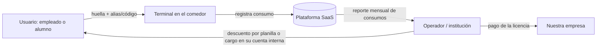

# 11 — Hoja de ruta comercial: modelo de sistema cerrado

**Fecha:** 27/10/2026.

**Convenciones** (las mismas de los documentos 00–10):
- **(I)** = inferencia propia.
- **[F#]** = fuente en `09_fuentes_y_evidencias.md`.
- Las metas numéricas son **objetivos del proyecto**, no datos de mercado.
- No hay precios ni tamaños de mercado inventados: se indica cómo obtenerlos.

> **Aviso:** las conclusiones legales son hipótesis para validar con un abogado (ver `05` §5). No es asesoría legal.

## 1. Qué es el modelo

Un **único operador** cobra a un **grupo conocido de personas** por consumos dentro de un recinto. La huella identifica a quién se le carga el consumo.

**Ejemplos de recinto (I, a validar):**
- Comedor corporativo, o concesionario de alimentación dentro de una empresa.
- Comedor o cafetería universitaria.
- Comedor de un campamento (minero, industrial).
- Gimnasio o club con consumos internos.

**Qué vende la empresa:** software como servicio (licencia por terminal o por usuario activo) más la instalación. La empresa **no** cobra a los consumidores, **no** guarda su dinero y **no** liquida fondos a nadie.

### 1.1 Flujo del dinero recomendado: pospago



- El consumo se registra y el **operador** lo cobra con un mecanismo que ya tiene: descuento por planilla, cuenta del alumno, factura mensual o subsidio de la empresa.
- **El dinero de los usuarios nunca pasa por la plataforma.** Ese es el punto que hace viable el modelo (ver §2).
- **Evitar en la primera versión:** saldos prepagados recargables administrados por la plataforma. Podrían ser emisión de dinero electrónico (Ley 29985, supervisada por la SBS; **no verificado**, ver `05` §2.3).

## 2. Por qué es más viable que la plataforma abierta

Cada barrera que bloquea el modelo abierto se reduce o desaparece en un sistema cerrado.

| Barrera | Plataforma abierta ("pagar con huella en cualquier comercio") | Sistema cerrado pospago | Fuente |
|---|---|---|---|
| **Acceso a los pagos** | Requiere que un banco acepte la huella en lugar de chip + PIN (Res. SBS 2286-2024). No hay socio identificado | No toca tarjetas: el operador cobra por planilla o cuenta interna. **No depende de ningún banco** | [F8], `05` §3 |
| **Regulación BCRP** | Contratar comercios y liquidarles fondos = Aceptador de Pagos: registro, cuenta recaudadora, liquidación en 48 h, multas | No contrata comercios para cobrarles por ventas ni liquida fondos. **Probablemente fuera del reglamento** (I; confirmar con abogado o consulta al BCRP) | [F5] art. 3.2, 3.4 |
| **Efecto red** | El cliente solo se registra si muchos comercios aceptan la huella, y viceversa | Un solo operador y un solo lugar. Se puede registrar a todos en la inducción | [F10, F11] |
| **Precisión** | Buscar entre millones de personas: con 10 000 usuarios un impostor coincide con alguien ~63 % de las veces (FMR 1/10 000) | Pocos cientos o miles de usuarios, y con alias o código la búsqueda es 1:1 | `03` §2 |
| **Costo del hardware** | Miles de terminales que alguien debe financiar (lo que quebró a Pay By Touch) | Pocos terminales por cliente; los paga o alquila el cliente | [F10], `06` |
| **Competencia** | Yape, Plin, QR y tarjeta sin contacto son gratuitos y masivos | Se compite con carné, vale, ticket, lista en papel o QR interno. La ventaja de la huella es que **no se presta ni se olvida** (I) | [F3, F4] |
| **Registro** | Hay que convencer a cada persona por separado | Registro en un lugar controlado, con personal presente | `04` §2 |
| **Antecedentes** | Pay By Touch quebró; Amazon One cerró | Hay casos cerrados en campus y parques temáticos (Sthaler en universidades británicas, Liquid en Huis Ten Bosch), aunque como pilotos | [F14, F15] |

**Lo que no cambia:** sigue siendo **biometría, un dato sensible** (Ley 29733 y DS 016-2024-JUS). Eso implica consentimiento escrito, inscripción del banco de datos, reporte de incidentes en 48 h y protección de las plantillas [F7].

**Riesgo nuevo propio de este modelo:** el consentimiento debe ser **libre**. Una persona puede sentir que no puede negarse ante su empleador o su universidad. **Siempre debe existir una alternativa sin huella** (carné, código o QR) que no penalice a quien no se registre (I; confirmar con abogado).

**Lo que se pierde:**
- El mercado es mucho más pequeño.
- El ingreso por cliente es modesto.
- Es un negocio de **software B2B para operadores**, no una revolución en los pagos.

A cambio, es un negocio que **se puede probar con poco capital y sin un banco**.

## 3. Problema que se debe confirmar

Estos problemas son **hipótesis** (I). La fase 0 existe para confirmarlos o descartarlos.

| Hipótesis | Por qué importaría | Cómo se mide |
|---|---|---|
| H1: los carnés, vales o tickets se prestan, se pierden o se falsifican | Pérdida económica para el operador o la empresa que subsidia | Preguntar cuántos casos detectan al mes y cuánto les cuesta |
| H2: las filas en hora punta son un problema medible | El tiempo de almuerzo es limitado | Cronometrar la cola actual |
| H3: conciliar consumos para planilla o subsidios es manual y propenso a errores | Horas de trabajo administrativo | Preguntar quién lo hace y cuánto tarda |
| H4: los usuarios aceptarían registrar su huella si hay alternativa y transparencia | Sin registro no hay producto | % de registro en el piloto |

Si **ninguna** de H1–H3 resulta un problema con costo concreto para el operador, el modelo no tiene comprador. En ese caso hay que detenerse.

## 4. Cliente y propuesta de valor

| Elemento | Definición inicial (a validar) |
|---|---|
| **Quién paga** | El operador del comedor (concesionario) o la institución que subsidia (área de RR. HH. o Administración) |
| **Quién decide** | Jefe de servicios generales, de RR. HH. o de administración; dueño del concesionario |
| **Quién usa** | Empleados, alumnos o socios mayores de edad |
| **Segmento inicial recomendado** | Comedores corporativos o de campamento con consumo subsidiado (I): hay un pagador claro, consumo diario y control de subsidios |
| **Excluir al inicio** | Colegios y menores de edad (consentimiento de los padres y mayor sensibilidad) |
| **Propuesta de valor** | "Cada consumo queda asignado a la persona correcta, sin carnés que se presten, y el reporte para planilla sale solo" |

## 5. Modelo de ingresos

| Componente | Tipo | Cómo se fija el precio |
|---|---|---|
| Instalación y registro inicial de usuarios | Pago único | Por horas de trabajo en sitio |
| Licencia mensual por terminal | Recurrente | Por entrevistas de disposición a pagar (§7, fase 0) |
| Licencia por usuario activo (alternativa) | Recurrente | Igual que la anterior |
| Venta o alquiler del lector | Única o recurrente | Costo del lector + margen; precios de lectores en `06` |

**No se fijan precios en este documento** porque no hay datos de disposición a pagar.

**Fórmula para evaluar cada cliente:**

```
Margen mensual por cliente =
    ingreso mensual (licencias)
  − hardware amortizado
  − soporte (horas × costo hora)
  − nube
  − parte de los costos fijos de cumplimiento (seguro, abogado, auditoría)
```

**Regla de decisión:** si con el precio que los clientes declaran estar dispuestos a pagar el margen es negativo para un cliente típico, el modelo no funciona aunque haya interés.

## 6. Producto: qué falta respecto del prototipo del TSP

El prototipo del TSP (`07`, `10`) usa dinero simulado y está pensado para medir. Para un piloto real con un cliente hace falta:

| Funcionalidad | En el TSP | Para el piloto comercial |
|---|---|---|
| Verificación 1:1 con alias o código | Sí | Sí |
| Motor de transacciones simulado | Sí | Se convierte en **registro de consumos** pospago |
| Catálogo de productos o menú y precios del operador | No | Sí |
| Límites de consumo y subsidios por persona | No | Sí |
| Reporte o exportación para planilla o facturación | No | **Sí: es lo que el cliente compra** |
| Método alternativo sin huella (código o QR) | Opcional | **Obligatorio** |
| Flujos de consentimiento, revocación y derechos ARCO | Básico | Completo, con evidencia guardada |
| Borrado de plantillas al dar de baja a una persona | Al final del estudio | Automático y auditable |
| Lector con detección de dedos falsos | Opcional | Recomendado |
| Funcionamiento sin internet (cola local y sincronización) | No | Recomendado: el comedor no puede detenerse |
| Soporte e instalación del agente local | Manual | Procedimiento documentado |

## 7. Hoja de ruta por fases

Cada fase tiene un **criterio de salida**. Si no se cumple, se detiene o se pivota; no se avanza "por inercia".

### Fase 0 — Descubrimiento (en paralelo al TSP, meses 1–4)

**Objetivo:** confirmar que existe un comprador con un problema que cuesta dinero.

**Acciones:**
1. 15–20 entrevistas con operadores de comedores, concesionarios, áreas de RR. HH. y administradores de campus. Usar la guía de `04` §6 y añadir:
   - "¿Cómo controlan hoy quién consume y cuánto?"
   - "¿Cuántas veces al mes detectan carnés prestados o consumos mal asignados? ¿Cuánto les cuesta?"
   - "¿Quién arma el reporte para planilla y cuánto tiempo le toma?"
   - "Si esto se resolviera, ¿qué presupuesto mensual tendría y quién lo aprobaría?"
   - "¿Qué les preocuparía de registrar huellas de su personal?"
2. Cronometrar la cola en hora punta en 2–3 comedores (con permiso).
3. Mostrar el prototipo del TSP en las entrevistas de segunda ronda.

**Criterio de salida:**
- Al menos 3 organizaciones confirman H1, H2 o H3 con un costo concreto.
- Al menos 2 firman una **carta de intención** para un piloto.
- Hay un rango de precio declarado.

**Si no se cumple:** detener la comercialización y cerrar el proyecto como caso académico.

### Fase 1 — Base legal y societaria (meses 4–6)

**Objetivo:** confirmar que el modelo pospago no requiere licencias financieras y dejar listo el cumplimiento de datos personales.

**Acciones:**
1. Opinión legal sobre tres preguntas:
   - ¿El modelo pospago queda fuera de la Circular 0026-2026-BCRP y de la Ley 29985? Si hay dudas, hacer la consulta formal al BCRP (Disp. Final Sexta y Octava) [F5].
   - ¿El consentimiento de un empleado o alumno es válido si existe una alternativa sin huella?
   - ¿Quién es el responsable del tratamiento y quién el encargado: la institución o la plataforma?
2. Confirmar con la UPC la **propiedad intelectual** del código del TSP y si puede usarse comercialmente (**no verificado**).
3. Constituir la empresa **solo si** hay cartas de intención.
4. Preparar los documentos de cumplimiento:
   - Política de privacidad.
   - Formato de consentimiento.
   - Contrato de encargo de tratamiento con el cliente.
   - Procedimiento de incidentes (48 h).
   - Procedimiento ARCO.
   - Inscripción del banco de datos (confirmar si corresponde a la plataforma o al cliente).

**Criterio de salida:** opinión legal favorable al modelo pospago, o con condiciones que se pueden cumplir.

**Si no se cumple:** rediseñar el flujo del dinero según la opinión, o detener.

### Fase 2 — Producto para piloto (meses 5–8)

**Objetivo:** convertir el prototipo en un producto que un operador pueda usar a diario.

**Acciones:** construir lo de §6. Hacer una prueba de penetración básica antes de registrar a personas reales.

**Criterio de salida:**
- El sistema funciona una semana completa en un entorno de prueba con datos ficticios.
- Ningún consumo se duplica ni se pierde.
- Los procesos de consentimiento y borrado están probados.

### Fase 3 — Piloto con un cliente (meses 8–11, unas 8–12 semanas)

**Objetivo:** demostrar en uso real que la solución resuelve el problema y que el cliente pagaría.

**Condiciones del piloto:**
- Acuerdo firmado con métricas de éxito definidas de antemano.
- **Pago simbólico o descuento**, no gratis: así se prueba la disposición a pagar (I).
- Alternativa sin huella siempre disponible.

**Métricas (objetivos del proyecto, no normativos):**

| Métrica | Objetivo |
|---|---|
| Usuarios que aceptan registrarse | ≥ 60 % de los elegibles |
| Consumos hechos con huella entre los registrados | ≥ 80 % |
| Rechazos de personas legítimas en campo (FNMR con hasta 3 intentos) | ≤ 2 % |
| Tiempo por consumo frente a la línea base medida en la fase 0 | Igual o menor |
| Reducción de consumos mal asignados (H1) o del tiempo de conciliación (H3) | Medible frente a la línea base |
| Incidentes de seguridad o de datos | 0 |
| Decisión del cliente al terminar | Firma un contrato pagado |

**Criterio de salida:** el cliente del piloto firma un contrato pagado.

**Si no se cumple:** analizar por qué (adopción, precio, problema mal definido) y volver a la fase 0 con otro segmento una sola vez. Si falla de nuevo, detener.

### Fase 4 — Repetibilidad (meses 11–18)

**Objetivo:** comprobar que se puede vender más allá del primer cliente.

**Acciones:**
1. Cerrar 2–4 clientes más del mismo segmento.
2. Documentar la instalación para que no dependa de los fundadores.
3. Calcular el margen real por cliente con la fórmula de §5.

**Criterio de salida:**
- Al menos 3 clientes que pagan.
- Margen positivo por cliente.
- Costo de soporte por cliente estable o en baja.

### Fase 5 — Escalar o evolucionar (desde el mes 18)

Con clientes reales y métricas de campo, hay tres caminos posibles:
1. **Crecer en el mismo nicho:** más comedores y campamentos.
2. **Ampliar a otros recintos cerrados:** gimnasios, clubes, universidades.
3. **Usar los datos del piloto para acercarse a un banco o adquirente** como proveedor de tecnología (modelo A de la recomendación anterior). Ahí los resultados en campo son la credencial.

## 8. Riesgos propios de este modelo

| Riesgo | Prob. | Impacto | Mitigación |
|---|---|---|---|
| El problema existe pero el cliente no paga lo suficiente | M-A | A | Medir la disposición a pagar en la fase 0 y cobrar algo en el piloto |
| Consentimiento cuestionado por la relación laboral o académica | M | A | Alternativa sin huella obligatoria; opinión legal en la fase 1 |
| El mercado es pequeño | A | M | Aceptarlo como negocio de nicho o usarlo de puente al modelo A |
| Un competidor de control de asistencia ya ofrece algo parecido (I, **no investigado**) | M | M | Buscar proveedores locales de control de acceso o asistencia biométrica en la fase 0 |
| Filtración de plantillas | B-M | Muy A | Cifrado, sin imágenes, borrado automático, seguro de ciberriesgo |
| Lector o internet caídos en hora punta | M | A | Modo sin conexión y alternativa con código |
| La UPC limita el uso comercial del código del TSP | Desconocida | A | Consultarlo en la fase 1; si es necesario, reescribir el producto |
| Un tercero de la cadena (concesionario) se niega a usarlo aunque la institución quiera | M | M | Incluir al concesionario en las entrevistas y en el acuerdo del piloto |

**Nota sobre competencia:** la investigación de `01` buscó competidores **de pagos**. Los proveedores de **control de asistencia o comedores con huella** en Perú no se investigaron. Pueden existir y ser competidores directos de este modelo. Es lo primero que hay que revisar en la fase 0.

## 9. Resumen de decisiones

| Fase | Pregunta | Si la respuesta es "no" |
|---|---|---|
| 0 | ¿Hay ≥ 3 organizaciones con un problema que les cuesta dinero y ≥ 2 cartas de intención? | Detener |
| 1 | ¿El modelo pospago es legal sin licencia financiera? | Rediseñar o detener |
| 2 | ¿El producto funciona una semana sin pérdidas de datos? | Seguir corrigiendo antes del piloto |
| 3 | ¿El cliente del piloto firma un contrato pagado? | Un intento más con otro segmento; luego detener |
| 4 | ¿Hay ≥ 3 clientes con margen positivo? | Evaluar si conviene seguir como negocio pequeño o detener |
